<p align="center"> 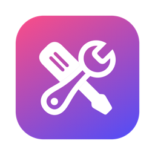</p>

# Boîte à outils

[English](README.md) · [Français](README.fr.md) · **Español**

**Cuida tu ordenador sin romper nada, en Windows y en Mac.** Inicio, servicios, limpieza, archivos grandes, ajustes ocultos, hardware, sensores, reparaciones: todo se explica con claridad, nada se modifica sin tu consentimiento y cada cambio se puede deshacer desde el Historial.

**8 idiomas**: español, inglés, francés, alemán, italiano, portugués, chino y japonés. El idioma de Windows o del Mac se elige automáticamente. Para cambiarlo: en Windows, el menú de idiomas en la parte inferior de la barra lateral (al instante); en Mac, *Ajustes ocultos › Boîte à outils › Idioma* (en el próximo inicio, con un botón Reiniciar).

Dos aplicaciones nativas, una para cada sistema, reunidas en este repositorio:

| | Windows 10 y 11 | macOS 14 o posterior |
|---|---|---|
| Carpeta | [`windows/`](windows/) (Rust, interfaz web WebView2) | [`macos/`](macos/) (Swift, SwiftUI) |
| Descargar | `BoiteAOutils-Setup.exe` | `Boite-a-outils-<versión>.pkg` o `.dmg` |

👉 **[Descargar la última versión](https://github.com/jeremdevgit/boite-a-outils/releases/latest)**

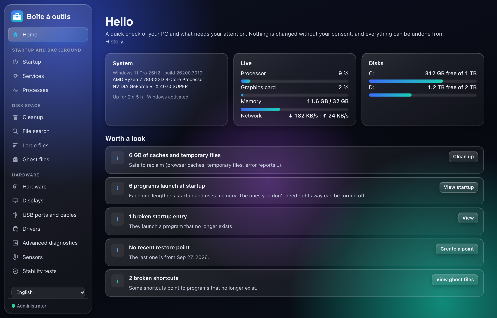

---

## Búsqueda de archivos y filtros

La pestaña **Búsqueda de archivos**, en Windows y macOS, encuentra archivos y carpetas por su nombre o ruta completa. Elige una carpeta o unidad, crea su índice local y busca con varias palabras o comodines (`*.pdf`, `informe?`). Filtra por archivos/carpetas, tamaño o fecha de modificación, ordena los resultados, muestra un elemento en el Explorador/Finder o copia su ruta.

El primer análisis puede tardar varios minutos. El índice permanece en memoria durante la sesión de la aplicación; reconstrúyelo para incluir los cambios del disco. Se omiten las carpetas sin acceso y no se recorren enlaces. No se calculan tamaños de carpetas y se muestran hasta 500 resultados. No se envía ningún contenido ni ruta de archivo a Internet.

Windows también incluye filtros en **Inicio, Servicios, Procesos, Aplicaciones, Sysinternals e Historial**, además de filtros de tamaño para instaladores y archivos olvidados. La selección en bloque afecta a la lista visible; cambiar el filtro de tamaño desmarca los elementos ocultos.

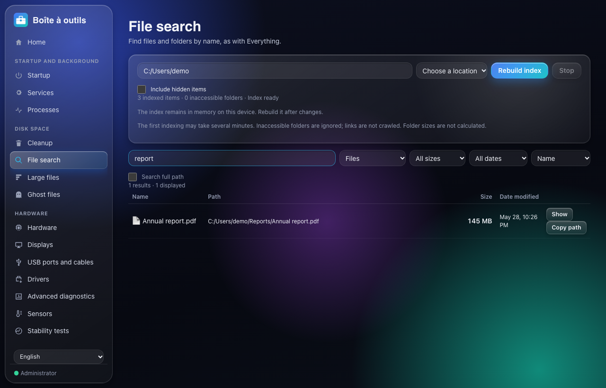

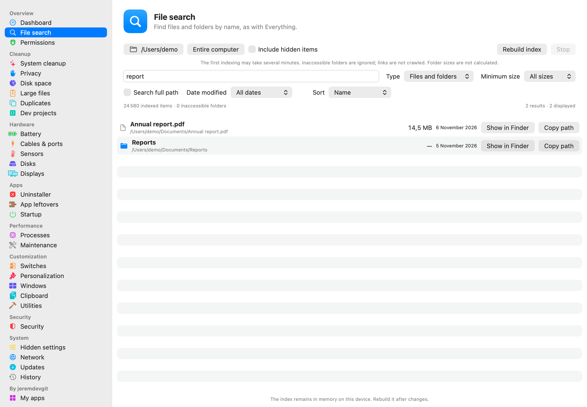


## Windows

| Sección | Qué hace |
|---|---|
| **Inicio, servicios, procesos** | Lo que se inicia con Windows (programas, tareas programadas, entradas rotas), servicios explicados uno por uno, procesos con su consumo. |
| **Limpieza** | Cachés y archivos temporales de Windows, de los navegadores, de las aplicaciones y de los juegos. Los elementos marcados por defecto no tienen consecuencias; los demás se explican. |
| **Archivos grandes y fantasma** | Lo que ocupa espacio, duplicados, versiones antiguas de aplicaciones, instaladores olvidados, accesos directos rotos, restos de programas desinstalados. |
| **Hardware** | Procesador, memoria, tarjetas gráficas, discos (salud SMART), pantallas, puertos USB y cables, controladores, sensores (temperaturas, ventiladores), pruebas de estabilidad. |
| **Rendimiento, personalización, ajustes** | Ajustes documentados y reversibles en un clic: juegos, energía, barra de tareas transparente, Explorador de archivos, privacidad, publicidad. Los «trucos» sin efecto medible aparecen con la razón por la que no se incluyen. |
| **Salud y reparación** | Puntos de restauración, comprobación y reparación de Windows (SFC, DISM), herramientas Sysinternals, copia de seguridad limpia, instalación de los programas esenciales (winget). |
| **Historial** | Cada cambio queda registrado y se deshace en un clic. |
| **Mis programas** | Mis otros programas, con el enlace de descarga oficial. |

<p>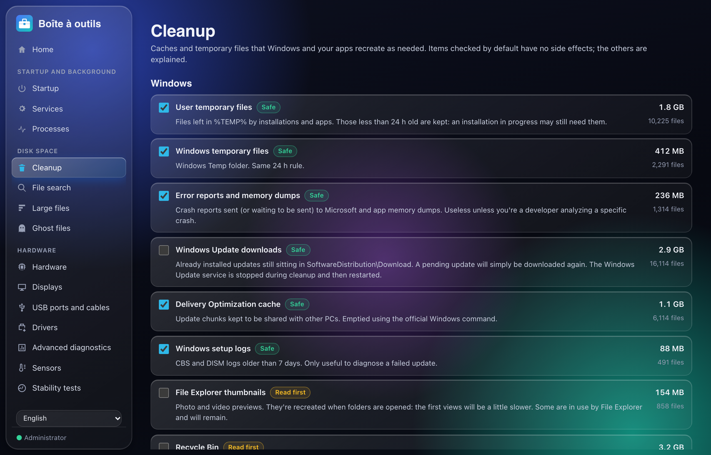 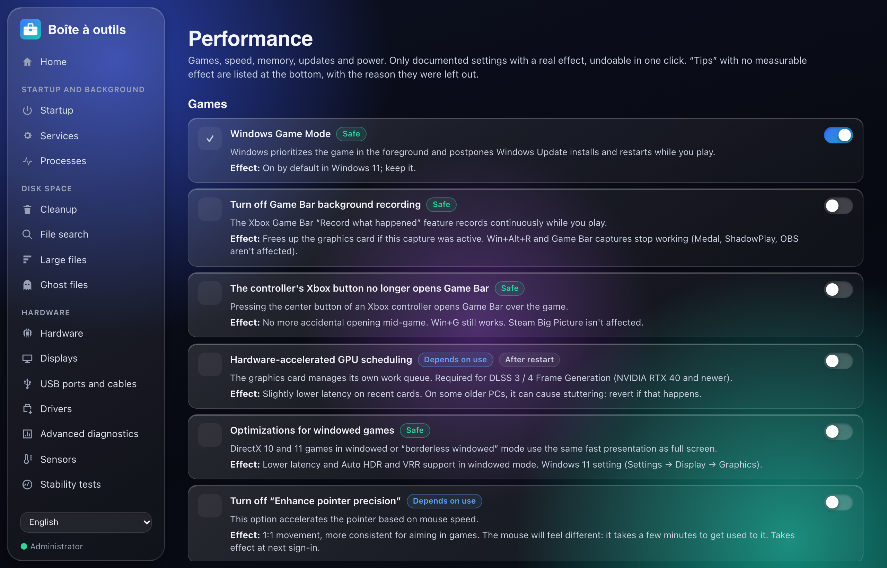</p>
<p>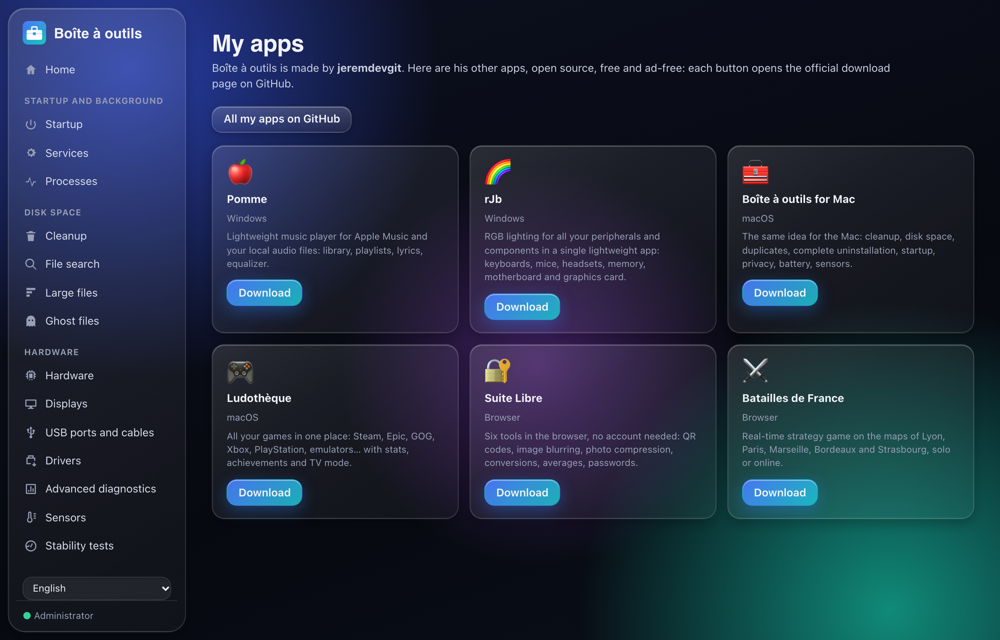 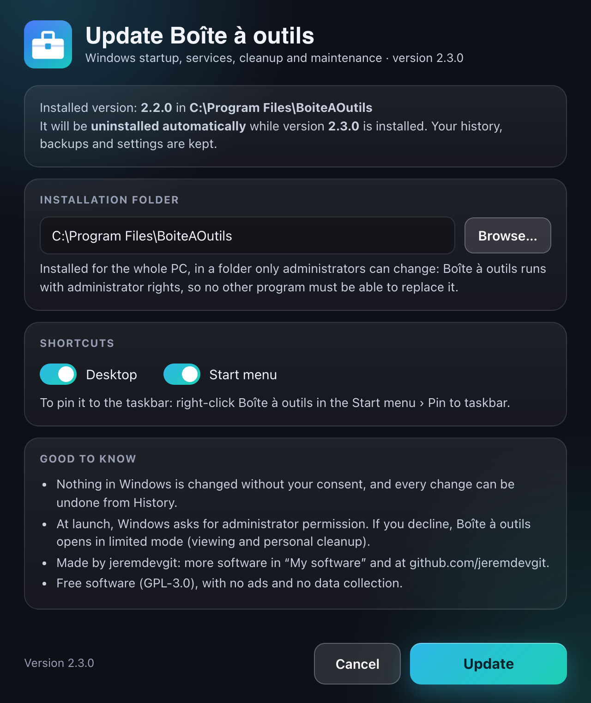</p>

### Instalar

1. Descarga `BoiteAOutils-Setup.exe` desde las [Releases](https://github.com/jeremdevgit/boite-a-outils/releases/latest) y ejecútalo.
2. **Una versión ya instalada se detecta y se desinstala automáticamente** durante la instalación de la nueva; se conservan el historial, las copias de seguridad y los ajustes.
3. La aplicación se instala en *Archivos de programa* (carpeta que solo los administradores pueden modificar), con sus accesos directos y su entrada en *Configuración › Aplicaciones*.

El ejecutable no está firmado con un certificado de pago: la primera vez, Windows SmartScreen puede mostrar «Windows protegió su PC». Haz clic en **Más información** y luego en **Ejecutar de todas formas**. Para verificar el archivo: `Get-FileHash .\BoiteAOutils-Setup.exe` y compáralo con `SHA256SUMS-windows.txt`.

Instalación silenciosa: `BoiteAOutils-Setup.exe /S`.

---

## macOS

Panel principal, limpieza del sistema, privacidad de los navegadores, espacio en disco, archivos grandes, duplicados, proyectos de desarrollo, desinstalador completo, restos huérfanos, inicio, procesos, mantenimiento, actualizaciones, ajustes ocultos, interruptores, personalización, organización de ventanas, portapapeles, red, batería, cables USB-C, sensores, discos, pantallas, seguridad, utilidades… El detalle de los módulos está en [`macos/README.md`](macos/README.md) (en francés).

<p>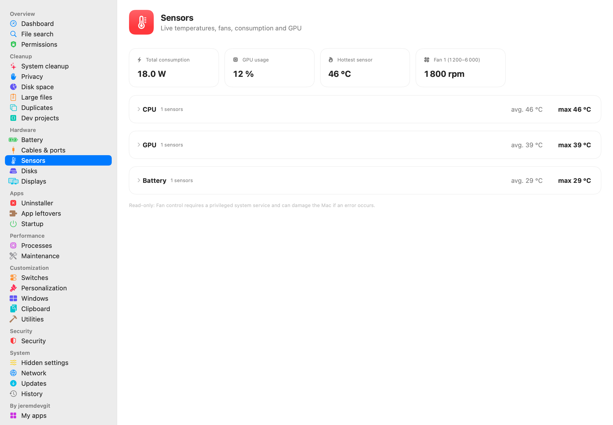 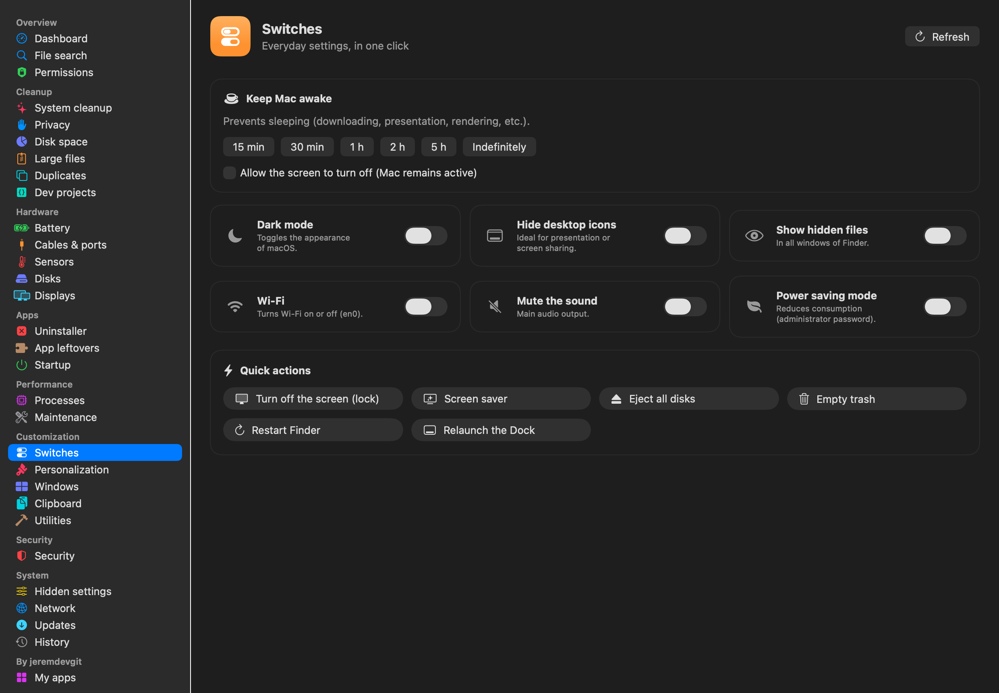</p>
<p>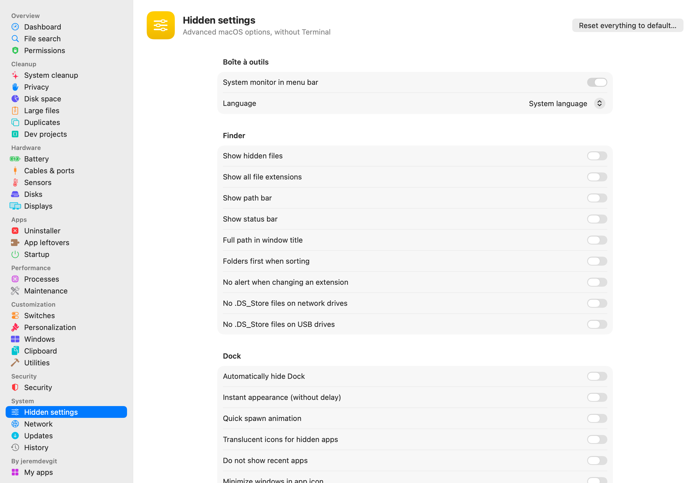 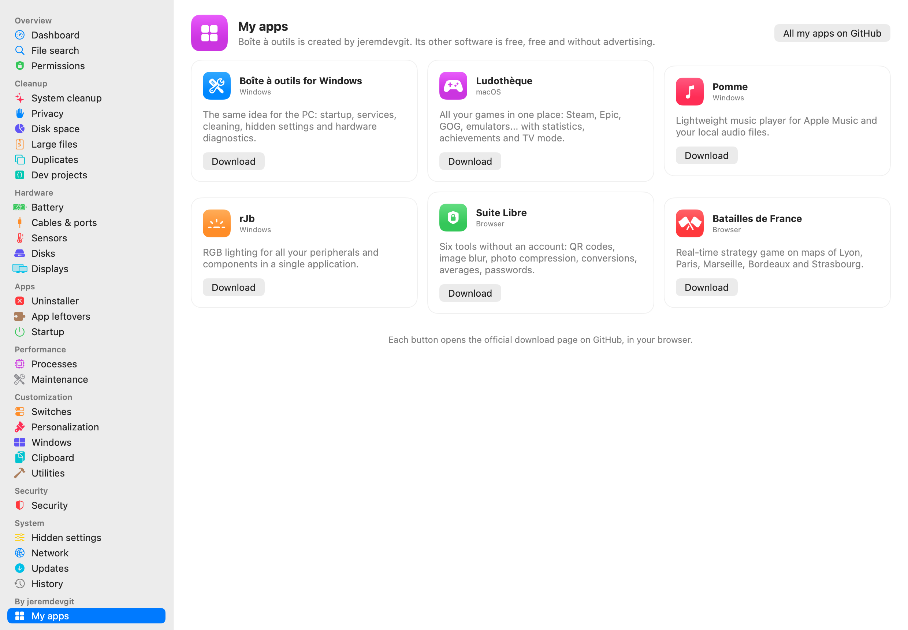</p>
<p>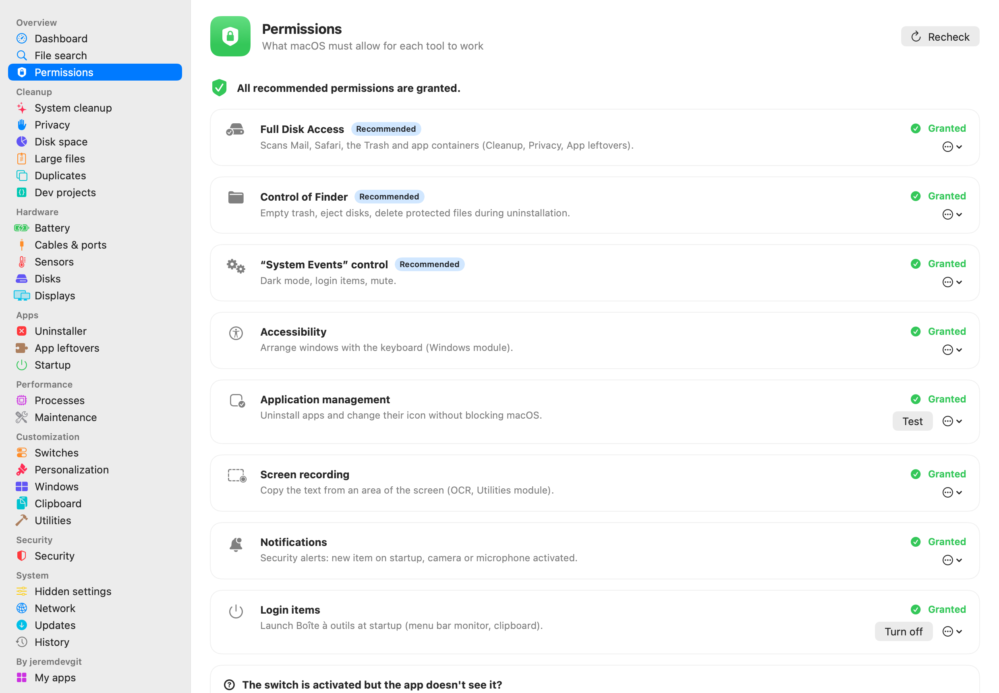 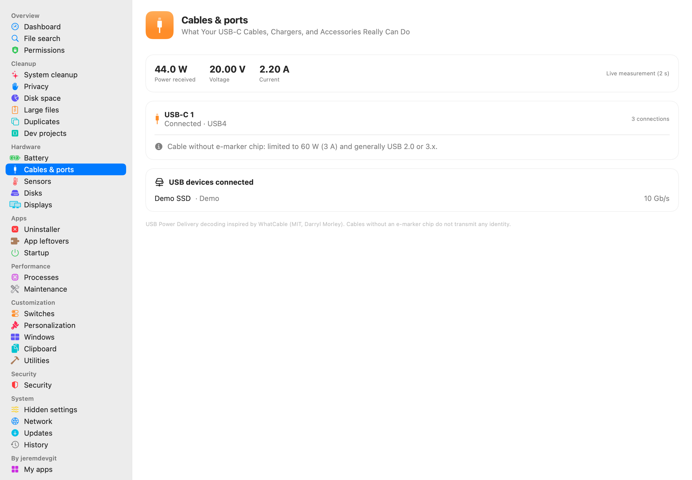</p>

### Instalar

- **Paquete `.pkg` (recomendado)**: doble clic y seguir el asistente. **La versión anterior se cierra y se elimina automáticamente** antes de instalar; se conservan tus ajustes y tu historial.
- **Imagen `.dmg`**: arrastra «Boîte à outils» a la carpeta Aplicaciones (el Finder ofrece sustituir la versión anterior).

La app no está notarizada por Apple: la primera vez, haz **clic derecho › Abrir**, o *Ajustes del Sistema › Privacidad y seguridad › Abrir igualmente*. Para comprobar los archivos: `shasum -a 256 -c SHA256SUMS-macos.txt --ignore-missing`.

Recomendado después: *Ajustes del Sistema › Privacidad y seguridad › Acceso total al disco* → añade «Boîte à outils» (la página **Permisos** de la aplicación te guía paso a paso).

---

## Privacidad y seguridad

- **Sin telemetría, sin cuenta, sin publicidad.** No se envía nada: todo se analiza en el ordenador.
- **Nada se modifica sin confirmación**; las eliminaciones pasan por la Papelera cuando es posible y quedan registradas en el Historial.
- **Windows**: se propone un punto de restauración antes del primer cambio; instalación en una carpeta protegida; bibliotecas del sistema cargadas solo desde System32 (sin secuestro de DLL desde la carpeta Descargas); páginas de la interfaz servidas desde el ejecutable, comandos nativos aceptados solo desde la interfaz; enlaces externos abiertos con los permisos del usuario, nunca como administrador.
- **Servicios contactados, solo cuando lo pides**: catálogo de Microsoft Update (controladores), live.sysinternals.com (herramientas Sysinternals), winget (programas esenciales), sitios de los fabricantes (enlaces), VirusTotal (huella de un archivo, en el navegador, macOS), api.ipify.org («Mostrar la IP pública», macOS), prueba de velocidad de Apple `networkQuality` (macOS).

¿Has encontrado una vulnerabilidad? Lee [SECURITY.md](SECURITY.md) antes de abrir una incidencia pública.

---

## Compilar

**Windows** — requisitos: [Rust](https://rustup.rs) estable y las *Build Tools* de Visual Studio (componente «Desarrollo para el escritorio con C++»).

```powershell
cd windows
cargo build --release              # target\release\BoiteAOutils.exe
.\tools\release.ps1                # versión distribuida + comprobaciones (ninguna ruta ni identificador de la máquina, sin dependencia del Runtime de Visual C++)
```

Las versiones publicadas se compilan con GitHub Actions ([`.github/workflows/windows.yml`](.github/workflows/windows.yml)) con este mismo script.

**macOS** — requisitos: macOS 14+, Xcode o las Command Line Tools.

```sh
cd macos
./build.sh                         # build/Boîte à outils.app (universal Apple Silicon + Intel)
./make_installer.sh                # dist/*.pkg, dist/*.dmg y SHA256SUMS-macos.txt
./Tests/run_tests.sh               # pruebas funcionales (no modifican ningún dato)
```

## Estructura del repositorio

```
windows/src/        programa de Windows (Rust): ventana, instalador, limpieza, hardware, sensores…
windows/ui/         interfaz (HTML, CSS, JavaScript sin framework)
windows/ps/         scripts de PowerShell llamados por la interfaz (lectura y ajustes de Windows)
windows/assets/     módulos del controlador PawnIO (lectura de los sensores de la placa base)
windows/tools/      compilación de la versión distribuida
macos/Sources/      aplicación de macOS (SwiftUI)
macos/Resources/    icono, Info.plist, scripts del paquete de instalación
captures/           capturas de pantalla (datos de demostración)
licences-tiers/     licencias de los componentes de terceros
```

## Licencia

Código bajo licencia **GNU GPL v3 o posterior**: consulta [LICENSE](LICENSE). Copyright © 2026 jeremdevgit.

Componentes de terceros (carpeta [licences-tiers](licences-tiers/)):

- módulos del controlador [PawnIO](https://github.com/namazso/PawnIO.Modules) (Windows): licencia LGPL-2.1, código fuente en github.com/namazso/PawnIO.Modules;
- decodificación de USB Power Delivery y acceso al SMC adaptados de WhatCable (macOS): licencia MIT.

## Mis otros programas

Todos libres, gratuitos y sin publicidad — [github.com/jeremdevgit](https://github.com/jeremdevgit):

| Programa | Para | En resumen |
|---|---|---|
| [Carnet de notes](https://github.com/jeremdevgit/carnet-rust) | Windows | notas locales cifradas y sincronización Joplin/Nextcloud experimental · [descargar ZIP](https://github.com/jeremdevgit/carnet-rust/releases/latest) |
| [JMeca](https://github.com/jeremdevgit/jmeca) | Windows, macOS, Linux | mantenimiento de vehículos cifrado, carpetas de clientes, historial y consumo |
| [Pomme](https://github.com/jeremdevgit/pomme) | Windows | reproductor de Apple Music y música local |
| [rJb](https://github.com/jeremdevgit/rjb) | Windows | la iluminación RGB de todos tus dispositivos en una sola aplicación |
| [Ludothèque](https://github.com/jeremdevgit/ludotheque) | macOS | todos tus juegos en un solo lanzador |
| [Suite Libre](https://jeremdevgit.github.io/suite-libre/) | navegador | seis herramientas sin cuenta: códigos QR, desenfoque, fotos, conversiones, promedios, contraseñas |
| [Batailles de France](https://github.com/jeremdevgit/batailles-de-france) | navegador | juego de estrategia en tiempo real sobre los mapas de cinco ciudades francesas |
