<p align="center"> 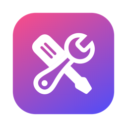</p>

# Boîte à outils

[English](README.md) · **Français** · [Español](README.es.md)

**Entretenir son ordinateur sans rien casser, sur Windows et sur Mac.** Démarrage, services, nettoyage, fichiers lourds, réglages cachés, matériel, capteurs, réparations : tout est expliqué en clair, rien n'est modifié sans ton accord, et chaque modification s'annule depuis l'Historique.

**8 langues** : français, anglais, espagnol, allemand, italien, portugais, chinois et japonais. La langue de Windows ou du Mac est choisie automatiquement. Pour en changer : sur Windows, menu des langues en bas de la barre latérale (immédiat) ; sur Mac, *Réglages cachés › Boîte à outils › Langue* (au prochain lancement, avec un bouton Relancer).

Deux applications natives, une pour chaque système, réunies dans ce dépôt :

| | Windows 10 et 11 | macOS 14 et plus récent |
|---|---|---|
| Dossier | [`windows/`](windows/) (Rust, interface web WebView2) | [`macos/`](macos/) (Swift, SwiftUI) |
| Télécharger | `BoiteAOutils-Setup.exe` | `Boite-a-outils-<version>.pkg` ou `.dmg` |

👉 **[Télécharger la dernière version](https://github.com/jeremdevgit/boite-a-outils/releases/latest)**

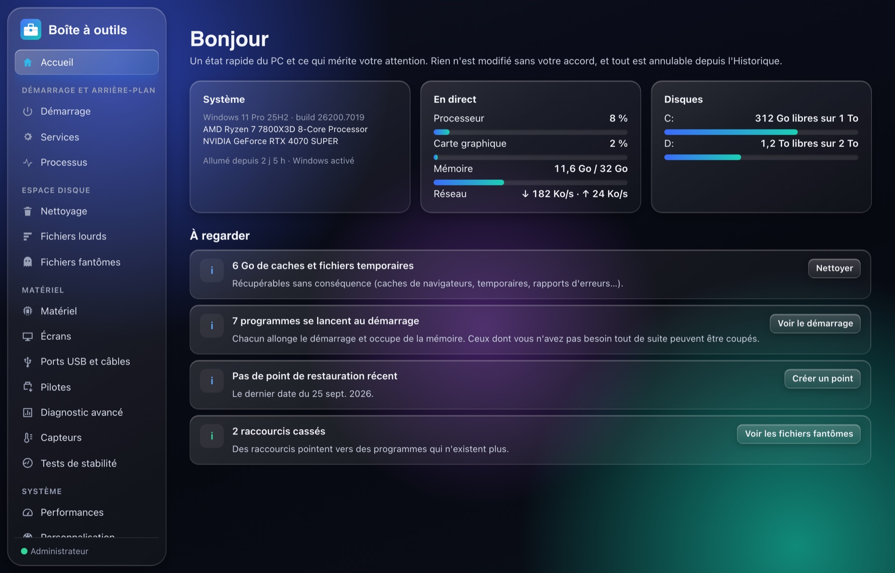

---

## Recherche de fichiers et filtres

L'onglet **Recherche de fichiers**, sur Windows et macOS, retrouve les fichiers et dossiers par leur nom ou leur chemin complet. Choisissez un dossier ou un disque, construisez son index local, puis cherchez avec plusieurs mots ou des jokers (`*.pdf`, `rapport?`). Filtrez par fichiers/dossiers, taille ou date de modification, triez les résultats, affichez un élément dans l'Explorateur/Finder ou copiez son chemin.

Le premier parcours peut prendre plusieurs minutes. L'index reste en mémoire pendant la session de l'application ; reconstruisez-le pour inclure les changements du disque. Les dossiers inaccessibles sont ignorés et les liens ne sont pas parcourus. Les tailles des dossiers ne sont pas calculées et la liste affiche jusqu'à 500 résultats. Aucun contenu ni chemin de fichier n'est envoyé en ligne.

Windows propose aussi des filtres dans **Démarrage, Services, Processus, Applications, Sysinternals et Historique**, ainsi que des filtres de taille pour les installateurs et archives oubliés. La sélection groupée porte sur la liste affichée ; changer le filtre de taille des archives décoche les éléments masqués.

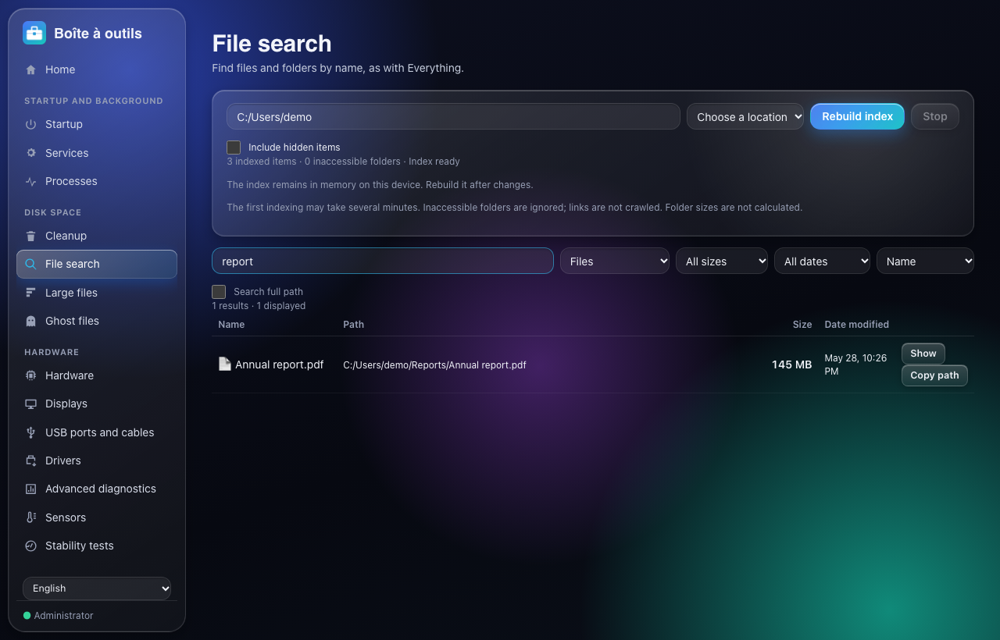

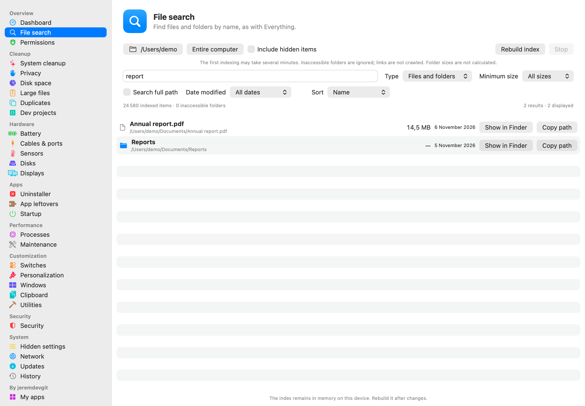


## Windows

| Rubrique | Ce qu'elle fait |
|---|---|
| **Démarrage, services, processus** | Ce qui se lance avec Windows (programmes, tâches planifiées, entrées cassées), services expliqués un par un, processus avec leur consommation. |
| **Nettoyage** | Caches et fichiers temporaires de Windows, des navigateurs, des applications et des jeux. Les éléments cochés par défaut sont sans conséquence ; les autres sont expliqués. |
| **Fichiers lourds et fantômes** | Ce qui prend de la place, doublons, anciennes versions d'applications, installateurs oubliés, raccourcis cassés, restes de logiciels désinstallés. |
| **Matériel** | Processeur, mémoire, cartes graphiques, disques (santé SMART), écrans, ports USB et câbles, pilotes, capteurs (températures, ventilateurs), tests de stabilité. |
| **Performances, personnalisation, réglages** | Réglages documentés et réversibles en un clic : jeux, alimentation, barre des tâches transparente, explorateur, confidentialité, publicités. Les « astuces » sans effet mesurable sont listées avec la raison de leur absence. |
| **Santé et réparation** | Points de restauration, vérification et réparation de Windows (SFC, DISM), outils Sysinternals, sauvegarde propre, installation des logiciels essentiels (winget). |
| **Historique** | Chaque modification est notée et s'annule en un clic. |
| **Mes logiciels** | Mes autres logiciels, avec le lien de téléchargement officiel. |

<p>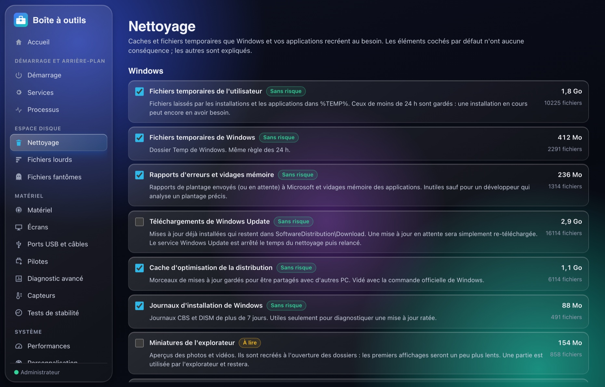 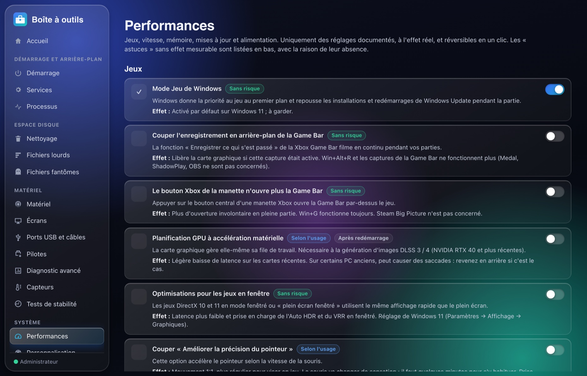</p>
<p>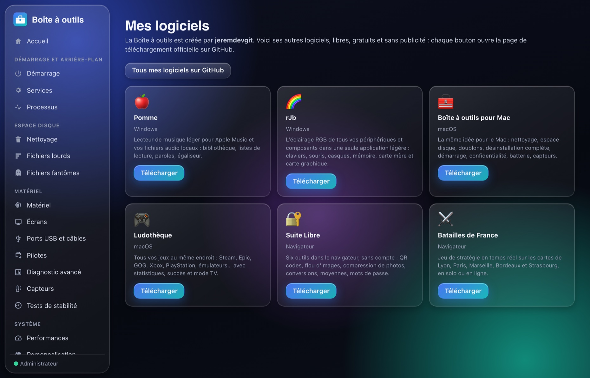 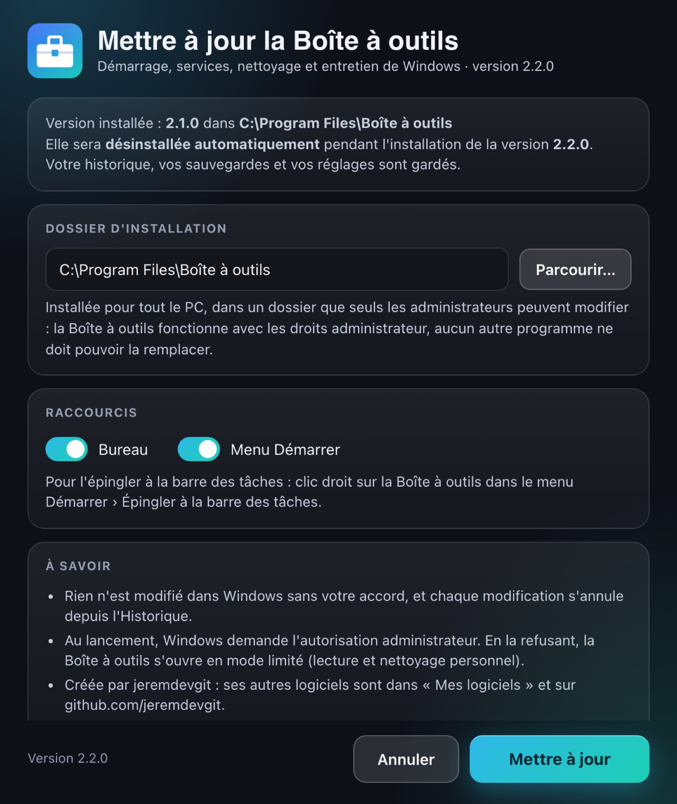</p>

### Installer

1. Télécharge `BoiteAOutils-Setup.exe` dans les [Releases](https://github.com/jeremdevgit/boite-a-outils/releases/latest) et lance-le.
2. **Une version déjà installée est détectée et désinstallée automatiquement** pendant l'installation de la nouvelle ; l'historique, les sauvegardes et les réglages sont gardés.
3. L'application s'installe dans *Program Files* (dossier que seuls les administrateurs peuvent modifier), avec ses raccourcis et son entrée dans *Paramètres › Applications*.

L'exécutable n'est pas signé par un certificat payant : au premier lancement, Windows SmartScreen peut afficher « Windows a protégé votre ordinateur ». Clique sur **Informations complémentaires** puis **Exécuter quand même**. Pour vérifier le fichier : `Get-FileHash .\BoiteAOutils-Setup.exe` et compare avec `SHA256SUMS-windows.txt`.

Installation silencieuse : `BoiteAOutils-Setup.exe /S`.

---

## macOS

Tableau de bord, nettoyage système, confidentialité des navigateurs, espace disque, gros fichiers, doublons, projets de développement, désinstallateur complet, restes orphelins, démarrage, processus, maintenance, mises à jour, réglages cachés, interrupteurs, personnalisation, rangement des fenêtres, presse-papiers, réseau, batterie, câbles USB-C, capteurs, disques, écrans, sécurité, utilitaires… Le détail des modules est dans [`macos/README.md`](macos/README.md).

<p>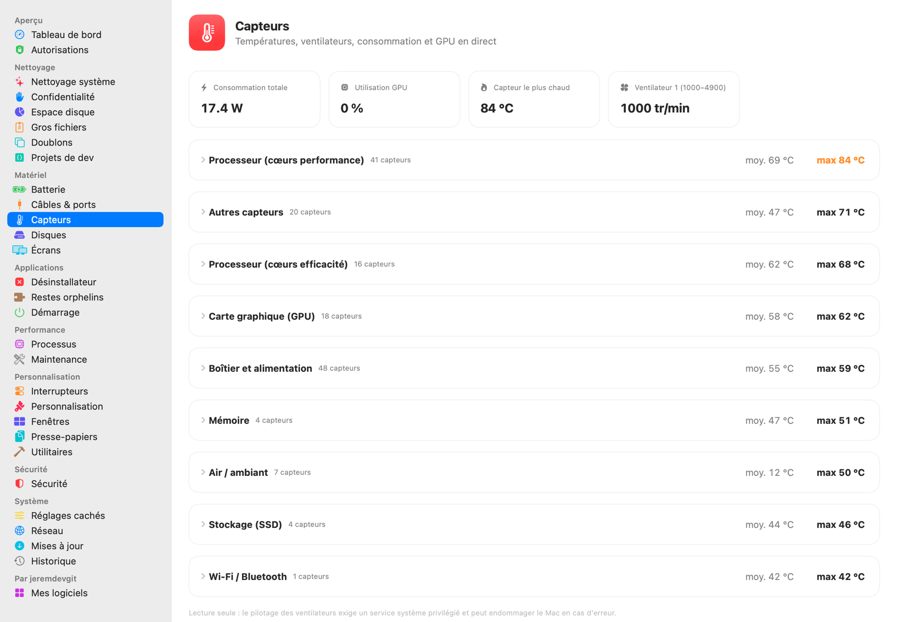 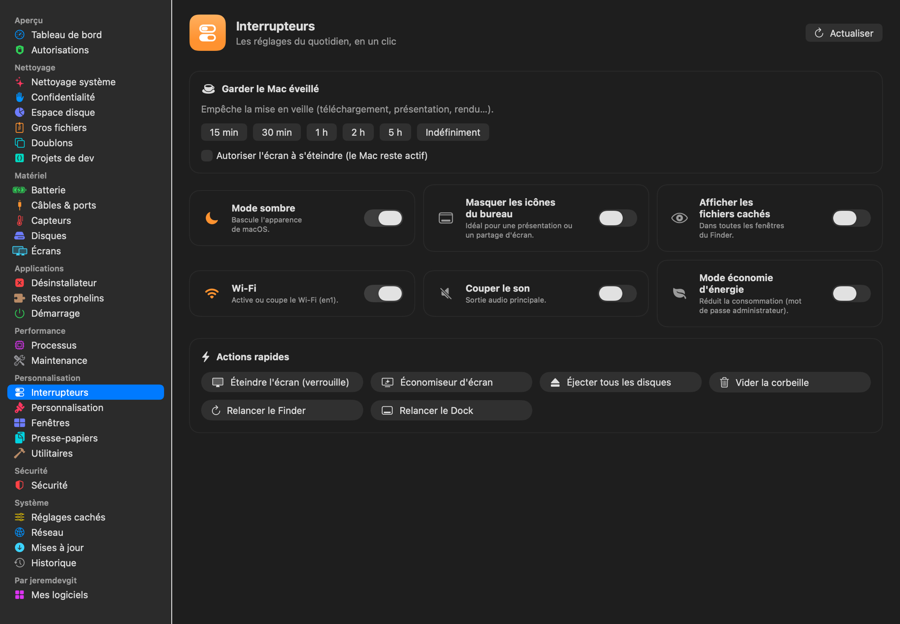</p>
<p>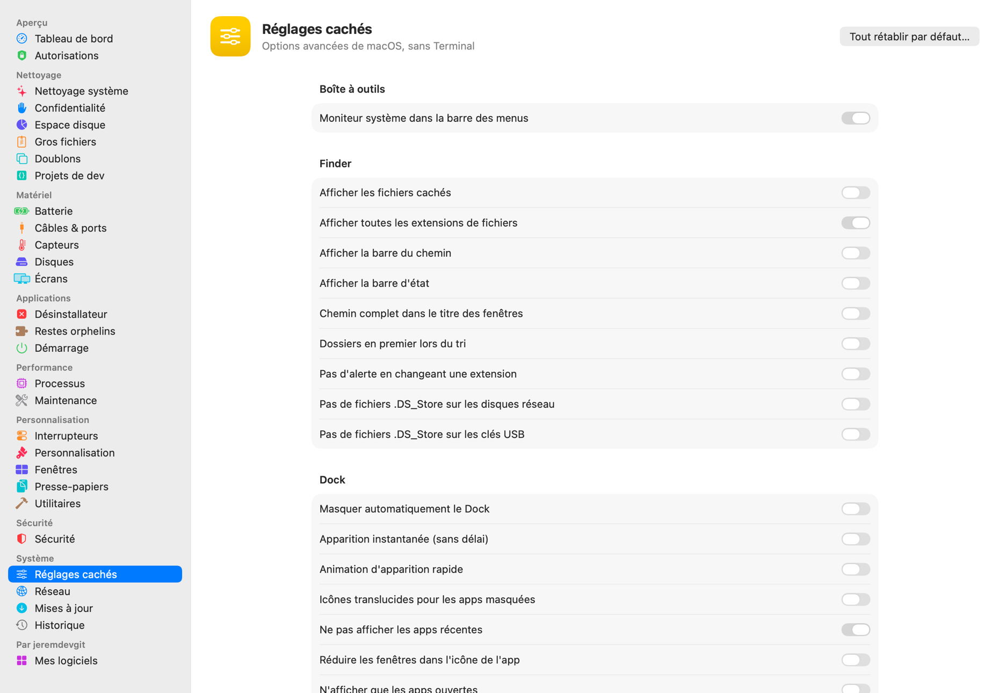 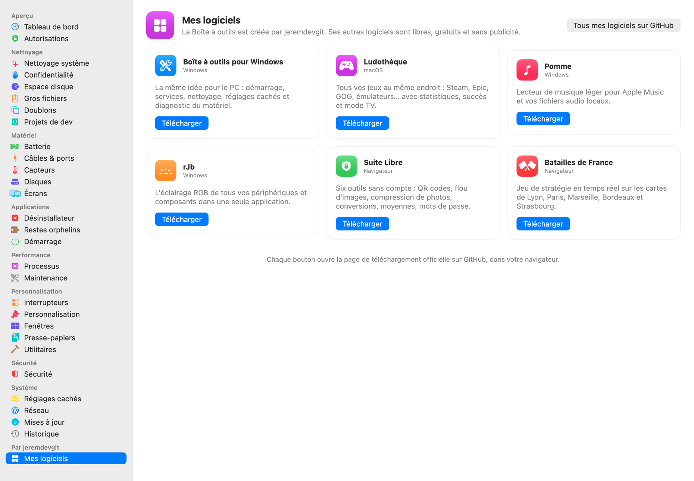</p>
<p>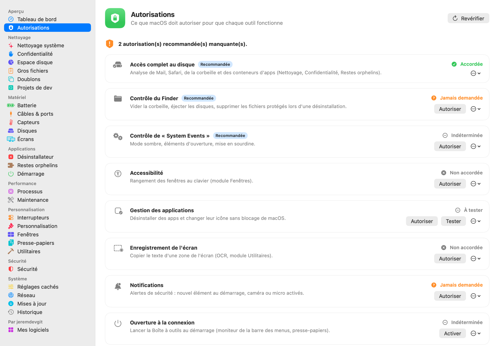 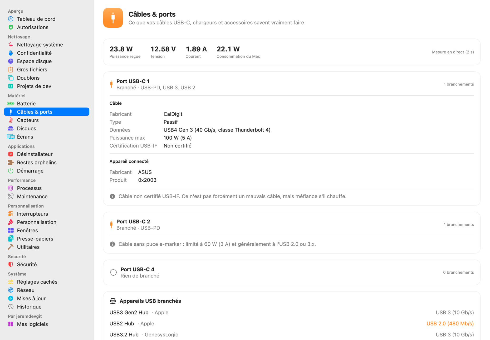</p>

### Installer

- **Paquet `.pkg` (conseillé)** : double-clic, puis suivre l'assistant. **L'ancienne version est fermée et retirée automatiquement** avant l'installation ; tes réglages et ton historique sont conservés.
- **Image `.dmg`** : glisser « Boîte à outils » sur le dossier Applications (le Finder propose de remplacer l'ancienne version).

L'application n'est pas notarisée par Apple : au premier lancement, fais **clic droit › Ouvrir**, ou *Réglages Système › Confidentialité et sécurité › Ouvrir quand même*. Pour vérifier les fichiers : `shasum -a 256 -c SHA256SUMS-macos.txt --ignore-missing`.

Conseillé ensuite : *Réglages Système › Confidentialité et sécurité › Accès complet au disque* → ajouter « Boîte à outils » (la page **Autorisations** de l'application guide pas à pas).

---

## Vie privée et sécurité

- **Aucune télémétrie, aucun compte, aucune publicité.** Rien n'est envoyé : tout est analysé sur l'ordinateur.
- **Rien n'est modifié sans confirmation** ; les suppressions passent par la Corbeille quand c'est possible et sont notées dans l'Historique.
- **Windows** : point de restauration proposé avant la première modification ; installation dans un dossier protégé ; bibliothèques système chargées uniquement depuis System32 (pas de détournement de DLL depuis le dossier Téléchargements) ; pages de l'interface servies depuis l'exécutable, commandes natives acceptées uniquement de l'interface ; liens externes ouverts avec les droits de l'utilisateur, jamais en administrateur.
- **Services contactés, uniquement à ta demande** : catalogue Microsoft Update (pilotes), live.sysinternals.com (outils Sysinternals), winget (logiciels essentiels), sites des fabricants (liens), VirusTotal (empreinte d'un fichier, dans le navigateur, macOS), api.ipify.org (« Afficher l'IP publique », macOS), test de débit Apple `networkQuality` (macOS).

Une faille ? Merci de lire [SECURITY.md](SECURITY.md) avant d'ouvrir un ticket public.

---

## Compiler

**Windows** — prérequis : [Rust](https://rustup.rs) stable et les *Build Tools* de Visual Studio (composant « Développement Desktop en C++ »).

```powershell
cd windows
cargo build --release              # target\release\BoiteAOutils.exe
.\tools\release.ps1                # version distribuée + contrôles (aucun chemin ni identifiant de la machine, aucune dépendance au Runtime Visual C++)
```

Les versions publiées sont construites par GitHub Actions ([`.github/workflows/windows.yml`](.github/workflows/windows.yml)) avec ce même script.

**macOS** — prérequis : macOS 14+, Xcode ou les Command Line Tools.

```sh
cd macos
./build.sh                         # build/Boîte à outils.app (universelle Apple Silicon + Intel)
./make_installer.sh                # dist/*.pkg, dist/*.dmg et SHA256SUMS-macos.txt
./Tests/run_tests.sh               # tests fonctionnels (ne modifient aucune donnée)
```

## Structure du dépôt

```
windows/src/        programme Windows (Rust) : fenêtre, installateur, nettoyage, matériel, capteurs…
windows/ui/         interface (HTML, CSS, JavaScript sans framework)
windows/ps/         scripts PowerShell appelés par l'interface (lecture et réglages de Windows)
windows/assets/     modules du pilote PawnIO (lecture des capteurs de la carte mère)
windows/tools/      construction de la version distribuée
macos/Sources/      application macOS (SwiftUI)
macos/Resources/    icône, Info.plist, scripts du paquet d'installation
captures/           captures d'écran (données de démonstration)
licences-tiers/     licences des composants tiers
```

## Licence

Code sous licence **GNU GPL v3 ou ultérieure** — voir [LICENSE](LICENSE). Copyright © 2026 jeremdevgit.

Composants tiers (dossier [licences-tiers](licences-tiers/)) :

- modules du pilote [PawnIO](https://github.com/namazso/PawnIO.Modules) (Windows) — licence LGPL-2.1, sources sur github.com/namazso/PawnIO.Modules ;
- décodage USB Power Delivery et accès au SMC adaptés de WhatCable (macOS) — licence MIT.

## Mes autres logiciels

Tous libres, gratuits et sans publicité — [github.com/jeremdevgit](https://github.com/jeremdevgit) :

| Logiciel | Pour | En bref |
|---|---|---|
| [JMeca](https://github.com/jeremdevgit/jmeca) | Windows, macOS, Linux | entretien automobile chiffré, dossiers clients, carnet et suivi du carburant |
| [Pomme](https://github.com/jeremdevgit/pomme) | Windows | lecteur Apple Music et musique locale |
| [rJb](https://github.com/jeremdevgit/rjb) | Windows | l'éclairage RGB de tous tes appareils dans une seule application |
| [Ludothèque](https://github.com/jeremdevgit/ludotheque) | macOS | tous tes jeux dans un seul lanceur |
| [Suite Libre](https://jeremdevgit.github.io/suite-libre/) | navigateur | six outils sans compte : QR codes, flou, photos, conversions, moyennes, mots de passe |
| [Batailles de France](https://github.com/jeremdevgit/batailles-de-france) | navigateur | jeu de stratégie en temps réel sur les cartes de cinq villes |
