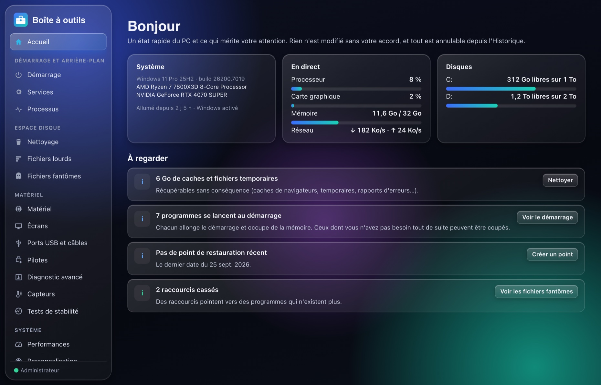
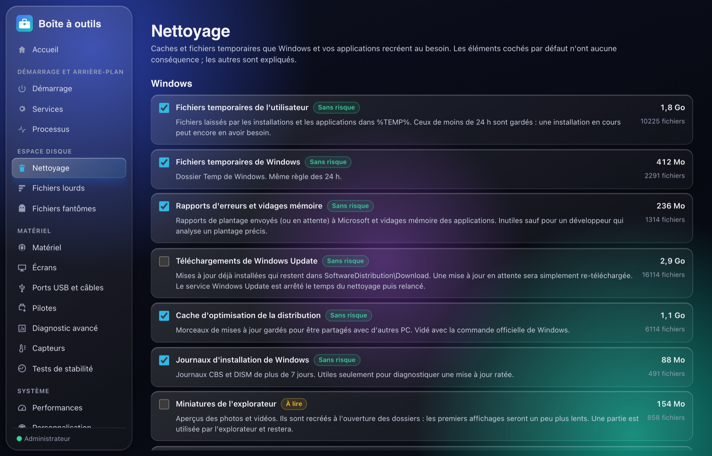
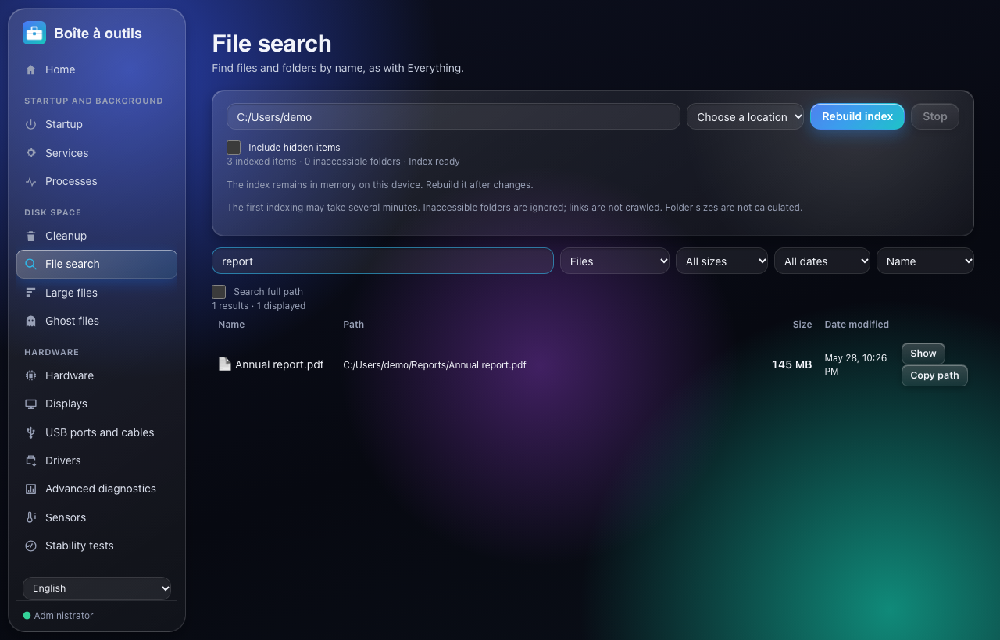
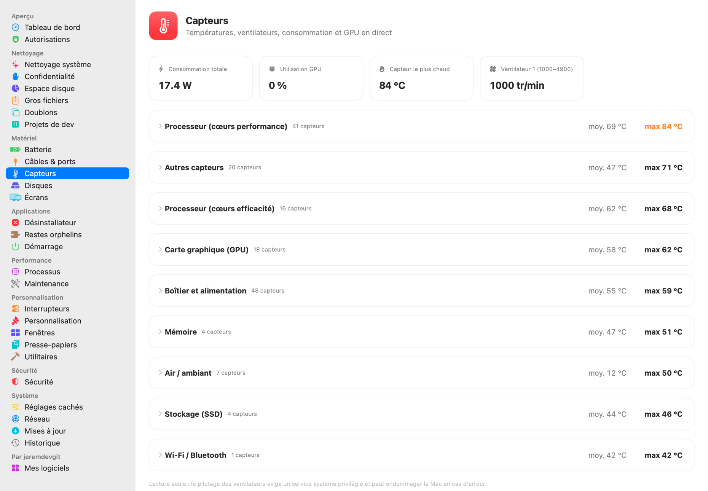
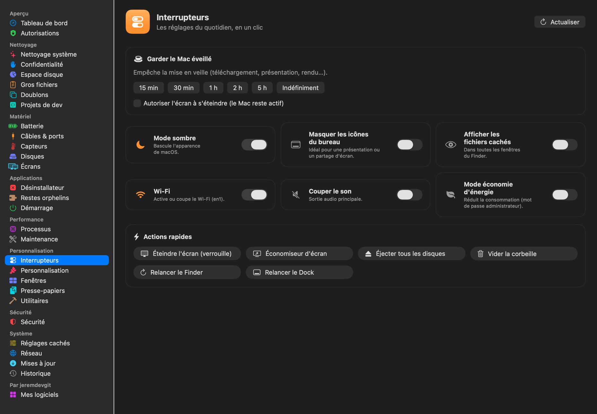

<p align="center"> </p>

<h1 align="center">Boîte à outils</h1>

<p align="center"><b>Entretenir son ordinateur sans rien casser : nettoyage, démarrage, matériel, capteurs, recherche de fichiers — tout est annulable.</b></p>

<p align="center"> <a href="https://github.com/jeremdevgit/boite-a-outils/releases"></a> <a href="LICENSE"></a> <a href="https://github.com/jeremdevgit/boite-a-outils/actions/workflows/windows.yml"></a></p>

<p align="center"><a href="README.md">English</a> · <b>Français</b> · <a href="README.es.md">Español</a> · <a href="README.de.md">Deutsch</a> · <a href="README.it.md">Italiano</a> · <a href="README.pt.md">Português</a> · <a href="README.zh.md">简体中文</a> · <a href="README.ja.md">日本語</a></p>

<p align="center"><a href="https://github.com/jeremdevgit/boite-a-outils/releases/latest"><b>⬇ Télécharger</b></a></p>



Boîte à outils explique chaque réglage avec des mots simples, ne change rien sans votre accord et note chaque modification dans un **Historique** annulable en un clic. Deux applications natives vivent dans ce dépôt : une pour **Windows 10/11** ([`windows/`](windows/), Rust + WebView2) et une pour **macOS 14+** ([`macos/`](macos/), Swift + SwiftUI).

## En bref

| | |
|---|---|
| **Catégorie** | 🛠️ Système et matériel |
| **Plateformes** | Windows · macOS |
| **Interface** | 8 langues (EN, FR, ES, DE, IT, PT, ZH, JA) |
| **Prix** | Gratuit, open source, sans publicité ni télémétrie |
| **État** | Stable |
| **Licence** | [GPL-3.0-or-later](LICENSE) |

## Ce qu'elle fait

| Domaine | Windows | macOS |
|---|---|---|
| **Démarrage et processus** | Programmes, tâches planifiées, services expliqués un par un, entrées cassées | Éléments d'ouverture, agents, processus |
| **Nettoyage** | Caches de Windows, des navigateurs, des applis et des jeux ; seuls les éléments sans risque sont cochés | Nettoyage système, confidentialité des navigateurs, projets de développement |
| **Espace disque** | Gros fichiers, doublons, anciennes versions, installateurs oubliés, restes | Gros fichiers, doublons, désinstallation complète, restes orphelins |
| **Recherche de fichiers** | Index local par nom ou chemin, jokers, filtres de taille et de date | Idem, façon Finder |
| **Matériel** | Processeur, mémoire, cartes graphiques, santé SMART, écrans, câbles USB, pilotes, capteurs, tests de stabilité | Capteurs, disques, écrans, batterie, câbles et ports USB-C |
| **Réglages** | Réglages documentés et réversibles (jeux, énergie, Explorateur, confidentialité, publicités) | Réglages cachés, interrupteurs, fenêtres, presse-papiers, réseau |
| **Réparation** | Points de restauration, SFC/DISM, Sysinternals, logiciels essentiels via winget | Maintenance, mises à jour, sécurité |

<p> </p>
<p> </p>

La recherche construit un index local du dossier ou du disque choisi (le premier passage peut prendre quelques minutes), affiche jusqu'à 500 résultats et n'envoie jamais de chemin ni de contenu en ligne. Les modules macOS sont détaillés dans [`macos/README.md`](macos/README.md).

## Installer

**Windows** — téléchargez `BoiteAOutils-Setup.exe` depuis la [dernière version](https://github.com/jeremdevgit/boite-a-outils/releases/latest) et lancez-le. Une version déjà installée est détectée et remplacée automatiquement ; historique, sauvegardes et réglages sont conservés. Installation silencieuse : `BoiteAOutils-Setup.exe /S`. L'exécutable n'est pas signé par un certificat payant : si SmartScreen s'affiche, choisissez **Informations complémentaires › Exécuter quand même**. Vérifiez-le avec `Get-FileHash` et `SHA256SUMS-windows.txt`.

**macOS** — le `.pkg` (recommandé) ferme et remplace l'ancienne version ; le `.dmg` s'installe par glisser-déposer. L'application n'est pas notarisée : la première fois, **clic droit › Ouvrir**. Accordez ensuite l'*Accès complet au disque* (la page **Autorisations** vous guide). Vérification : `shasum -a 256 -c SHA256SUMS-macos.txt --ignore-missing`.

## Sécurité et confidentialité

- **Ni télémétrie, ni compte, ni publicité.** Tout est analysé sur l'ordinateur.
- **Rien ne change sans confirmation.** Les suppressions passent par la Corbeille quand c'est possible ; sous Windows, un point de restauration est proposé avant la première modification.
- Installée dans un dossier modifiable seulement par les administrateurs ; DLL système chargées uniquement depuis System32 ; liens externes ouverts avec vos droits, jamais en administrateur.
- Services en ligne contactés uniquement à votre demande : catalogue Microsoft Update, live.sysinternals.com, winget, sites des fabricants, VirusTotal (empreinte d'un fichier, macOS), api.ipify.org et `networkQuality` d'Apple (macOS).

## Compiler

```powershell
# Windows — Rust stable + Visual Studio Build Tools (C++)
cd windows
cargo build --release
.\tools\release.ps1          # installateur distribué + vérifications
```

```sh
# macOS 14+ — Xcode ou Command Line Tools
cd macos
./build.sh                   # application universelle (Apple Silicon + Intel)
./make_installer.sh          # .pkg, .dmg et sommes de contrôle
./Tests/run_tests.sh
```

Les versions publiées sont construites par GitHub Actions ([`windows.yml`](.github/workflows/windows.yml)).

## Licence

GNU GPL v3 ou ultérieure — voir [LICENSE](LICENSE). Composants tiers dans [`licences-tiers/`](licences-tiers/) : modules [PawnIO](https://github.com/namazso/PawnIO.Modules) (LGPL-2.1, capteurs Windows) et code USB Power Delivery / SMC adapté de WhatCable (MIT, macOS).

---

Une faille de sécurité ? Signalez-la en privé (voir [SECURITY.md](SECURITY.md)) plutôt que dans un ticket public.

## Mes autres logiciels libres

Tous gratuits, open source et sans publicité.

**🛠️ Système et matériel** — [rJb](https://github.com/jeremdevgit/rjb) · [LJ Hub](https://github.com/jeremdevgit/lj-hub) · [Decklight](https://github.com/jeremdevgit/decklight)

**📒 Productivité et données** — [Carnet de notes](https://github.com/jeremdevgit/carnet-rust) · [JMeca](https://github.com/jeremdevgit/jmeca) · [Suite Libre](https://jeremdevgit.github.io/suite-libre/)

**🎮 Musique et jeux** — [Pomme](https://github.com/jeremdevgit/pomme) · [Ludothèque](https://github.com/jeremdevgit/ludotheque) · [AutoDex](https://github.com/jeremdevgit/autodex) · [Batailles de France](https://github.com/jeremdevgit/batailles-de-france)
