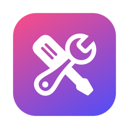
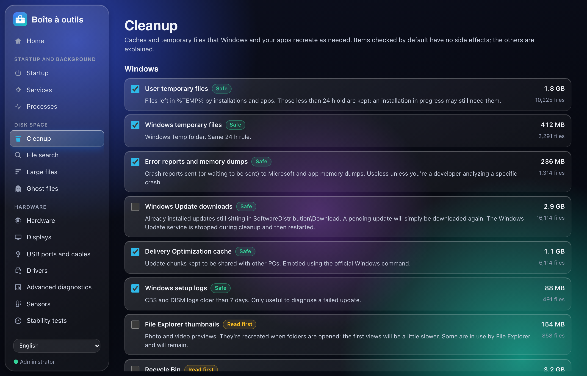
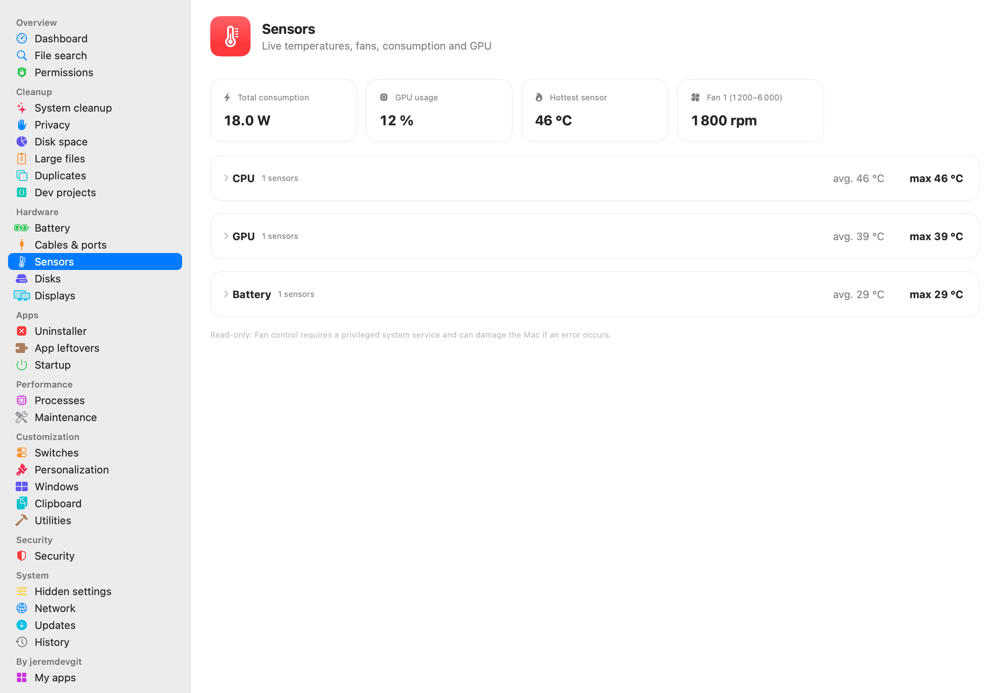

<p align="center"> </p>

<h1 align="center">Boîte à outils</h1>

<p align="center"><b>Prenditi cura del computer senza rompere nulla: pulizia, avvio, hardware, sensori, ricerca file — ogni modifica si può annullare.</b></p>

<p align="center"> <a href="https://github.com/jeremdevgit/boite-a-outils/releases"></a> <a href="LICENSE"></a> <a href="https://github.com/jeremdevgit/boite-a-outils/actions/workflows/windows.yml"></a></p>

<p align="center"><a href="README.md">English</a> · <a href="README.fr.md">Français</a> · <a href="README.es.md">Español</a> · <a href="README.de.md">Deutsch</a> · <b>Italiano</b> · <a href="README.pt.md">Português</a> · <a href="README.zh.md">简体中文</a> · <a href="README.ja.md">日本語</a></p>

<p align="center"><a href="https://github.com/jeremdevgit/boite-a-outils/releases/latest"><b>⬇ Scarica</b></a></p>


Boîte à outils spiega ogni impostazione con parole semplici, non cambia nulla senza il tuo consenso e registra ogni modifica in una **Cronologia** annullabile con un clic. Il repository contiene due app native: una per **Windows 10/11** ([`windows/`](windows/), Rust + WebView2) e una per **macOS 14+** ([`macos/`](macos/), Swift + SwiftUI).

## In breve

| | |
|---|---|
| **Categoria** | 🛠️ Sistema e hardware |
| **Piattaforme** | Windows · macOS |
| **Interfaccia** | 8 lingue (EN, FR, ES, DE, IT, PT, ZH, JA) |
| **Prezzo** | Gratuito, open source, senza pubblicità né telemetria |
| **Stato** | Stabile |
| **Licenza** | [GPL-3.0-or-later](LICENSE) |

## Cosa fa

| Area | Windows | macOS |
|---|---|---|
| **Avvio e processi** | Programmi, attività pianificate, servizi spiegati uno per uno, voci non valide | Elementi di login, agenti, processi |
| **Pulizia** | Cache di Windows, browser, app e giochi; selezionato solo ciò che è sicuro | Pulizia di sistema, privacy dei browser, progetti di sviluppo |
| **Spazio su disco** | File grandi, duplicati, vecchie versioni, installer dimenticati, residui | File grandi, duplicati, disinstallazione completa, residui orfani |
| **Ricerca file** | Indice locale per nome o percorso, caratteri jolly, filtri per dimensione e data | Lo stesso, in stile Finder |
| **Hardware** | CPU, RAM, GPU, stato SMART, schermi, cavi USB, driver, sensori, test di stabilità | Sensori, dischi, schermi, batteria, cavi e porte USB-C |
| **Impostazioni** | Modifiche documentate e reversibili (giochi, energia, Esplora file, privacy, pubblicità) | Impostazioni nascoste, interruttori, finestre, appunti, rete |
| **Riparazione** | Punti di ripristino, SFC/DISM, Sysinternals, app essenziali con winget | Manutenzione, aggiornamenti, sicurezza |

<p> </p>
<p> </p>

La ricerca crea un indice locale della cartella o dell'unità scelta (la prima scansione può richiedere qualche minuto), mostra fino a 500 risultati e non invia mai percorsi o contenuti online. I moduli macOS sono descritti in [`macos/README.md`](macos/README.md) (in francese).

## Installazione

**Windows** — scarica `BoiteAOutils-Setup.exe` dalla [versione più recente](https://github.com/jeremdevgit/boite-a-outils/releases/latest) ed eseguilo. Una versione già installata viene rilevata e sostituita automaticamente; cronologia, backup e impostazioni restano. Installazione silenziosa: `BoiteAOutils-Setup.exe /S`. L'eseguibile non è firmato con un certificato a pagamento: se compare SmartScreen, scegli **Ulteriori informazioni › Esegui comunque**. Verificalo con `Get-FileHash` e `SHA256SUMS-windows.txt`.

**macOS** — il `.pkg` (consigliato) chiude e sostituisce la versione precedente; il `.dmg` si installa trascinando. L'app non è notarizzata: la prima volta, **clic destro › Apri**. Poi concedi l'*Accesso completo al disco* (la pagina **Autorizzazioni** ti guida). Verifica: `shasum -a 256 -c SHA256SUMS-macos.txt --ignore-missing`.

## Sicurezza e privacy

- **Niente telemetria, account o pubblicità.** Tutto viene analizzato sul computer.
- **Nulla cambia senza conferma.** Ciò che elimini va nel Cestino quando possibile; su Windows viene proposto un punto di ripristino prima della prima modifica.
- Installata in una cartella modificabile solo dagli amministratori; DLL di sistema caricate solo da System32; link esterni aperti con i tuoi permessi, mai come amministratore.
- Servizi online solo su richiesta: catalogo Microsoft Update, live.sysinternals.com, winget, siti dei produttori, VirusTotal (hash di un file, macOS), api.ipify.org e `networkQuality` di Apple (macOS).

## Compilare

```powershell
# Windows — Rust stable + Visual Studio Build Tools (C++)
cd windows
cargo build --release
.\tools\release.ps1          # installer distribuito + controlli
```

```sh
# macOS 14+ — Xcode o Command Line Tools
cd macos
./build.sh                   # app universale (Apple Silicon + Intel)
./make_installer.sh          # .pkg, .dmg e checksum
./Tests/run_tests.sh
```

Le versioni pubblicate sono compilate da GitHub Actions ([`windows.yml`](.github/workflows/windows.yml)).

## Licenza

GNU GPL v3 o successiva — vedi [LICENSE](LICENSE). Componenti di terze parti in [`licences-tiers/`](licences-tiers/): moduli [PawnIO](https://github.com/namazso/PawnIO.Modules) (LGPL-2.1, sensori su Windows) e codice USB Power Delivery / SMC adattato da WhatCable (MIT, macOS).

---

Hai trovato una vulnerabilità? Segnalala in privato (vedi [SECURITY.md](SECURITY.md)) e non in una issue pubblica.

## Altro software libero di jeremdevgit

Tutti gratuiti, open source e senza pubblicità.

**🛠️ Sistema e hardware** — [rJb](https://github.com/jeremdevgit/rjb) · [LJ Hub](https://github.com/jeremdevgit/lj-hub) · [Decklight](https://github.com/jeremdevgit/decklight)

**📒 Produttività e dati** — [Carnet de notes](https://github.com/jeremdevgit/carnet-rust) · [JMeca](https://github.com/jeremdevgit/jmeca) · [Suite Libre](https://jeremdevgit.github.io/suite-libre/)

**🎮 Musica e giochi** — [Pomme](https://github.com/jeremdevgit/pomme) · [Ludothèque](https://github.com/jeremdevgit/ludotheque) · [AutoDex](https://github.com/jeremdevgit/autodex) · [Batailles de France](https://github.com/jeremdevgit/batailles-de-france)
