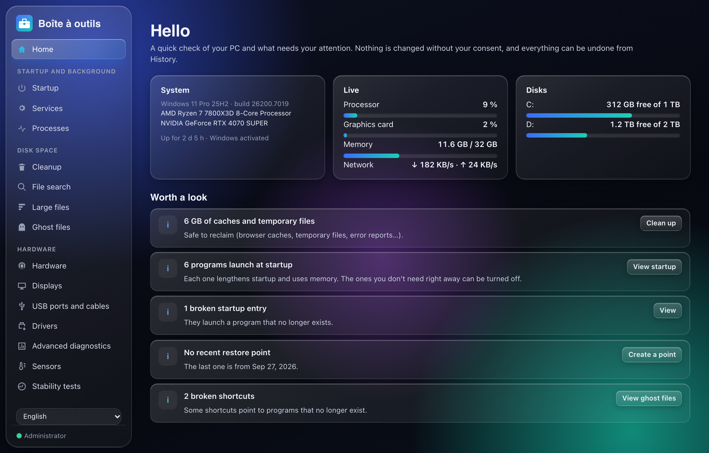

<p align="center"> </p>

<h1 align="center">Boîte à outils</h1>

<p align="center"><b>何も壊さずにパソコンをお手入れ：クリーンアップ、スタートアップ、ハードウェア、センサー、ファイル検索。すべての変更は元に戻せます。</b></p>

<p align="center"> <a href="https://github.com/jeremdevgit/boite-a-outils/releases"></a> <a href="LICENSE"></a> <a href="https://github.com/jeremdevgit/boite-a-outils/actions/workflows/windows.yml"></a></p>

<p align="center"><a href="README.md">English</a> · <a href="README.fr.md">Français</a> · <a href="README.es.md">Español</a> · <a href="README.de.md">Deutsch</a> · <a href="README.it.md">Italiano</a> · <a href="README.pt.md">Português</a> · <a href="README.zh.md">简体中文</a> · <b>日本語</b></p>

<p align="center"><a href="https://github.com/jeremdevgit/boite-a-outils/releases/latest"><b>⬇ ダウンロード</b></a></p>



Boîte à outils は各設定をわかりやすい言葉で説明し、同意なしには何も変更せず、すべての変更を**履歴**に記録してワンクリックで元に戻せます。このリポジトリには 2 つのネイティブアプリがあります：**Windows 10/11** 版（[`windows/`](windows/)、Rust + WebView2）と **macOS 14 以降**版（[`macos/`](macos/)、Swift + SwiftUI）。

## 概要

| | |
|---|---|
| **カテゴリー** | 🛠️ システムとハードウェア |
| **対応環境** | Windows · macOS |
| **表示言語** | 8 言語（英・仏・西・独・伊・葡・中・日） |
| **価格** | 無料・オープンソース・広告なし・テレメトリーなし |
| **ステータス** | 安定版 |
| **ライセンス** | [GPL-3.0-or-later](LICENSE) |

## できること

| 分野 | Windows | macOS |
|---|---|---|
| **スタートアップとプロセス** | プログラム、タスク スケジューラ、1 つずつ説明されたサービス、壊れた項目 | ログイン項目、起動エージェント、プロセス |
| **クリーンアップ** | Windows・ブラウザー・アプリ・ゲームのキャッシュ。安全な項目だけが既定でオン | システムクリーンアップ、ブラウザーのプライバシー、開発プロジェクト |
| **ディスク容量** | 大きなファイル、重複、古いバージョン、放置されたインストーラー、残りかす | 大きなファイル、重複、完全アンインストール、孤立した残りかす |
| **ファイル検索** | 名前またはパスによるローカル索引、ワイルドカード、サイズ・日付フィルター | 同様（Finder 風） |
| **ハードウェア** | CPU、メモリ、GPU、SMART 状態、ディスプレイ、USB ケーブル、ドライバー、センサー、安定性テスト | センサー、ドライブ、ディスプレイ、バッテリー、USB-C ケーブルとポート |
| **設定** | 説明付きで元に戻せる調整（ゲーム、電源、エクスプローラー、プライバシー、広告） | 隠し設定、スイッチ、ウインドウ、クリップボード、ネットワーク |
| **修復** | 復元ポイント、SFC/DISM、Sysinternals、winget による定番アプリ | メンテナンス、アップデート、セキュリティ |

<p> </p>
<p> </p>

ファイル検索は選んだフォルダーやドライブのローカル索引を作成し（初回は数分かかることがあります）、最大 500 件を表示します。パスや内容がオンラインに送られることはありません。macOS の各モジュールは [`macos/README.md`](macos/README.md)（フランス語）で説明しています。

## インストール

**Windows** — [最新リリース](https://github.com/jeremdevgit/boite-a-outils/releases/latest)から `BoiteAOutils-Setup.exe` をダウンロードして実行します。インストール済みのバージョンは自動的に検出・置き換えられ、履歴・バックアップ・設定は保持されます。サイレントインストール：`BoiteAOutils-Setup.exe /S`。有料証明書で署名されていないため、SmartScreen が表示されたら **詳細情報 › 実行** を選んでください。`Get-FileHash` と `SHA256SUMS-windows.txt` で確認できます。

**macOS** — `.pkg`（推奨）は旧バージョンを終了して置き換えます。`.dmg` はドラッグ＆ドロップでインストールします。公証されていないため、初回は **右クリック › 開く** を使ってください。その後*フルディスクアクセス*を許可します（**アクセス許可**ページが案内します）。確認：`shasum -a 256 -c SHA256SUMS-macos.txt --ignore-missing`。

## 安全性とプライバシー

- **テレメトリーなし、アカウント不要、広告なし。** 解析はすべてパソコン上で行われます。
- **確認なしには何も変更しません。** 削除したものは可能な限りごみ箱へ。Windows では最初の変更の前に復元ポイントの作成を提案します。
- 管理者しか変更できないフォルダーにインストール。システム DLL は System32 からのみ読み込み、外部リンクは管理者ではなくユーザー権限で開きます。
- オンラインサービスへの接続は依頼したときだけ：Microsoft Update カタログ、live.sysinternals.com、winget、メーカーのサイト、VirusTotal（ファイルのハッシュ、macOS）、api.ipify.org と Apple の `networkQuality`（macOS）。

## ソースからビルド

```powershell
# Windows — Rust stable + Visual Studio Build Tools (C++)
cd windows
cargo build --release
.\tools\release.ps1          # 配布用インストーラー + チェック
```

```sh
# macOS 14+ — Xcode または Command Line Tools
cd macos
./build.sh                   # ユニバーサルアプリ（Apple Silicon + Intel）
./make_installer.sh          # .pkg、.dmg、チェックサム
./Tests/run_tests.sh
```

公開版は GitHub Actions でビルドしています（[`windows.yml`](.github/workflows/windows.yml)）。

## ライセンス

GNU GPL v3 以降 — [LICENSE](LICENSE) を参照。サードパーティ製コンポーネントは [`licences-tiers/`](licences-tiers/)：[PawnIO](https://github.com/namazso/PawnIO.Modules) モジュール（LGPL-2.1、Windows のセンサー）と、WhatCable から移植した USB Power Delivery / SMC のコード（MIT、macOS）。

---

脆弱性を見つけたら、公開 Issue ではなく非公開で報告してください（[SECURITY.md](SECURITY.md) を参照）。

## jeremdevgit のその他のフリーソフトウェア

すべて無料・オープンソース・広告なし。

**🛠️ システムとハードウェア** — [rJb](https://github.com/jeremdevgit/rjb) · [LJ Hub](https://github.com/jeremdevgit/lj-hub) · [Decklight](https://github.com/jeremdevgit/decklight)

**📒 生産性とデータ** — [Carnet de notes](https://github.com/jeremdevgit/carnet-rust) · [JMeca](https://github.com/jeremdevgit/jmeca) · [Suite Libre](https://jeremdevgit.github.io/suite-libre/)

**🎮 音楽とゲーム** — [Pomme](https://github.com/jeremdevgit/pomme) · [Ludothèque](https://github.com/jeremdevgit/ludotheque) · [AutoDex](https://github.com/jeremdevgit/autodex) · [Batailles de France](https://github.com/jeremdevgit/batailles-de-france)
