<p align="center"> 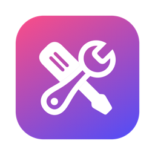</p>

# Boîte à outils

**English** · [Français](README.fr.md) · [Español](README.es.md)

**Look after your computer without breaking anything, on Windows and on Mac.** Startup, services, cleanup, large files, hidden settings, hardware, sensors, repairs: everything is explained in plain words, nothing is changed without your consent, and every change can be undone from the History.

**8 languages**: English, French, Spanish, German, Italian, Portuguese, Chinese and Japanese. Your Windows or Mac language is picked automatically. To switch: on Windows, the language menu at the bottom of the sidebar (instant); on Mac, *Hidden Settings › Boîte à outils › Language* (at the next launch, with a Relaunch button).

Two native apps, one for each system, gathered in this repository:

| | Windows 10 and 11 | macOS 14 or later |
|---|---|---|
| Folder | [`windows/`](windows/) (Rust, WebView2 web interface) | [`macos/`](macos/) (Swift, SwiftUI) |
| Download | `BoiteAOutils-Setup.exe` | `Boite-a-outils-<version>.pkg` or `.dmg` |

👉 **[Download the latest version](https://github.com/jeremdevgit/boite-a-outils/releases/latest)**

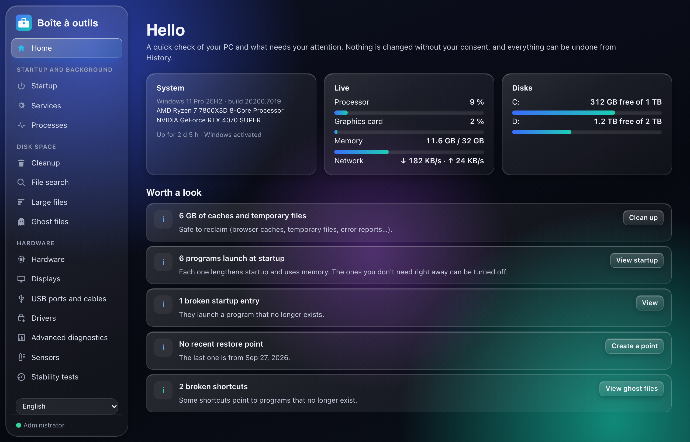

---

## File search and list filters

The **File search** tab on Windows and macOS finds files and folders by name or full path. Choose a folder or drive, build its local index, then search using several words or wildcards (`*.pdf`, `report?`). Filter by files/folders, size or modification date, sort the results, reveal an item in Explorer/Finder, or copy its path.

The first scan may take several minutes. The index stays in memory for the current app session; rebuild it to include filesystem changes. Inaccessible folders are skipped and links are not traversed. Folder sizes are not calculated, and the results list shows up to 500 matches. No file content or path is sent online.

Windows also has contextual filters in **Startup, Services, Processes, Apps, Sysinternals and History**, plus size filters for forgotten installers and archives. Bulk selection acts on the displayed list; changing an archive size filter clears hidden selections.

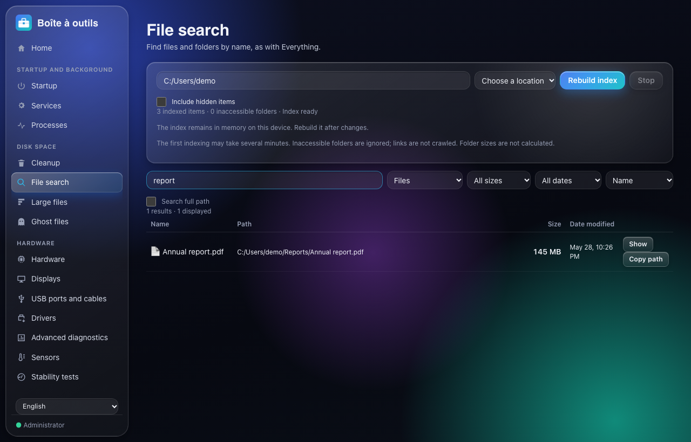

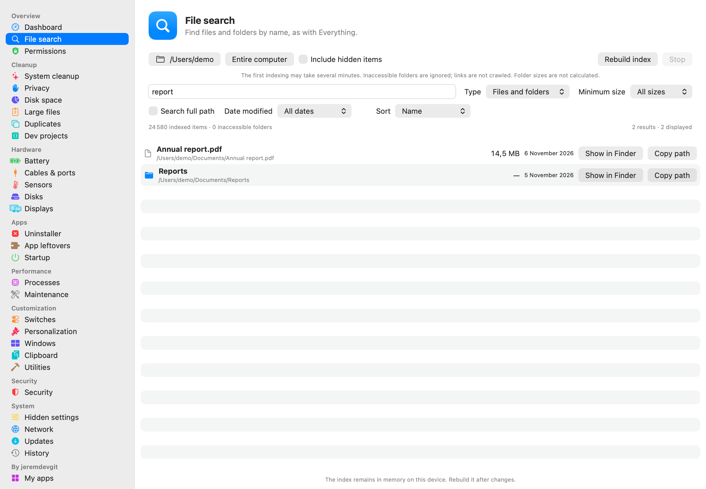


## Windows

| Section | What it does |
|---|---|
| **Startup, services, processes** | What launches with Windows (programs, scheduled tasks, broken entries), services explained one by one, processes with their resource use. |
| **Cleanup** | Caches and temporary files of Windows, browsers, apps and games. Items ticked by default are harmless; the others are explained. |
| **Large and ghost files** | What takes up space, duplicates, old app versions, forgotten installers, broken shortcuts, leftovers of uninstalled software. |
| **Hardware** | Processor, memory, graphics cards, drives (SMART health), displays, USB ports and cables, drivers, sensors (temperatures, fans), stability tests. |
| **Performance, customization, settings** | Documented settings, reversible in one click: games, power, transparent taskbar, File Explorer, privacy, ads. "Tips" with no measurable effect are listed with the reason they're left out. |
| **Health and repair** | Restore points, Windows check and repair (SFC, DISM), Sysinternals tools, clean backup, installing essential software (winget). |
| **History** | Every change is logged and can be undone in one click. |
| **My software** | My other software, with the official download link. |

<p>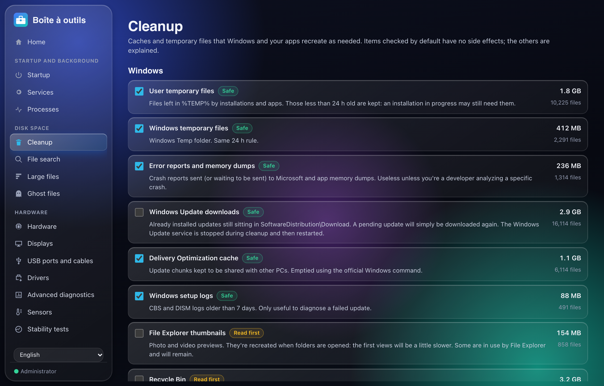 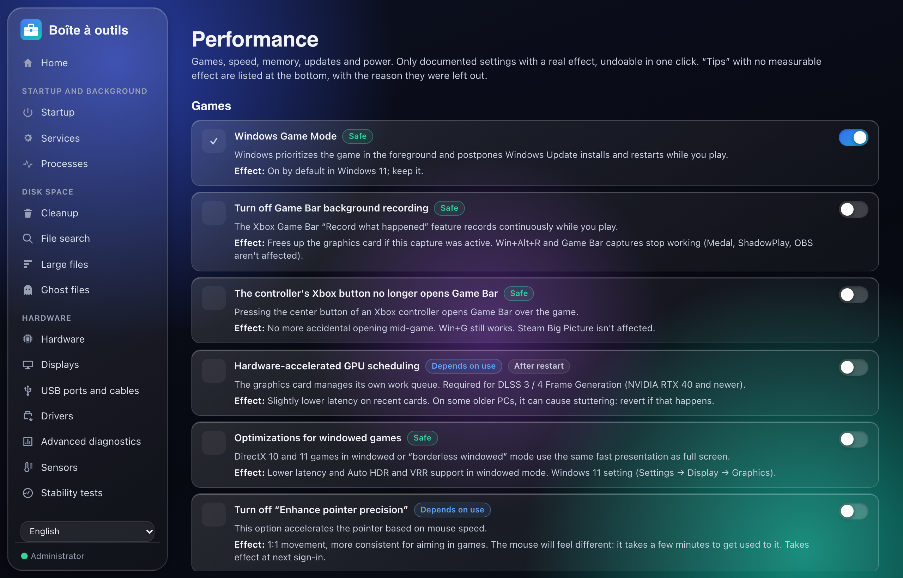</p>
<p>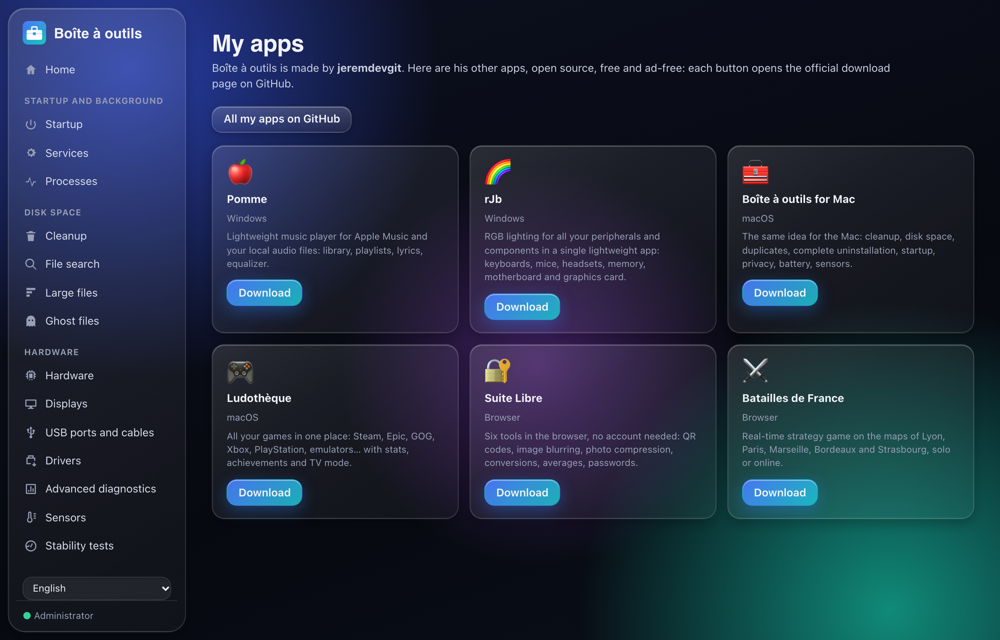 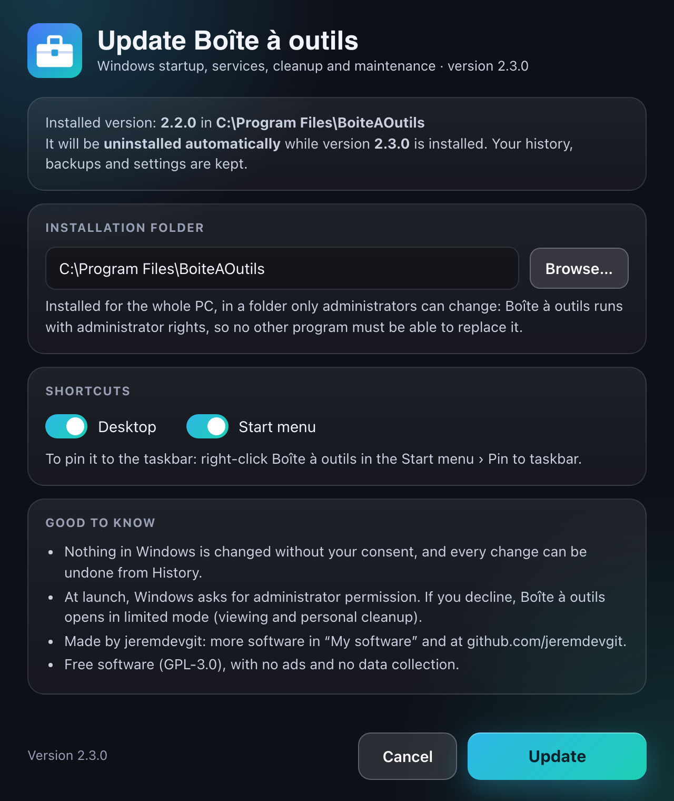</p>

### Installing

1. Download `BoiteAOutils-Setup.exe` from the [Releases](https://github.com/jeremdevgit/boite-a-outils/releases/latest) and run it.
2. **An already installed version is detected and uninstalled automatically** while the new one installs; history, backups and settings are kept.
3. The app installs into *Program Files* (a folder that only administrators can modify), with its shortcuts and its entry in *Settings › Apps*.

The executable isn't signed with a paid certificate: on first launch, Windows SmartScreen may show "Windows protected your PC". Click **More info** then **Run anyway**. To check the file: `Get-FileHash .\BoiteAOutils-Setup.exe` and compare with `SHA256SUMS-windows.txt`.

Silent install: `BoiteAOutils-Setup.exe /S`.

---

## macOS

Dashboard, system cleanup, browser privacy, disk space, large files, duplicates, development projects, complete uninstaller, orphaned leftovers, startup, processes, maintenance, updates, hidden settings, switches, customization, window tiling, clipboard, network, battery, USB-C cables, sensors, drives, displays, security, utilities… The modules are detailed in [`macos/README.md`](macos/README.md) (in French).

<p>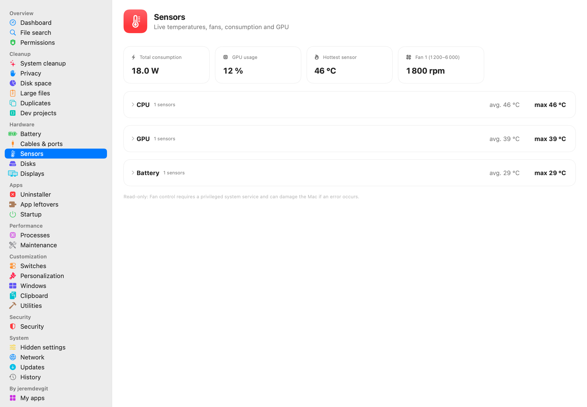 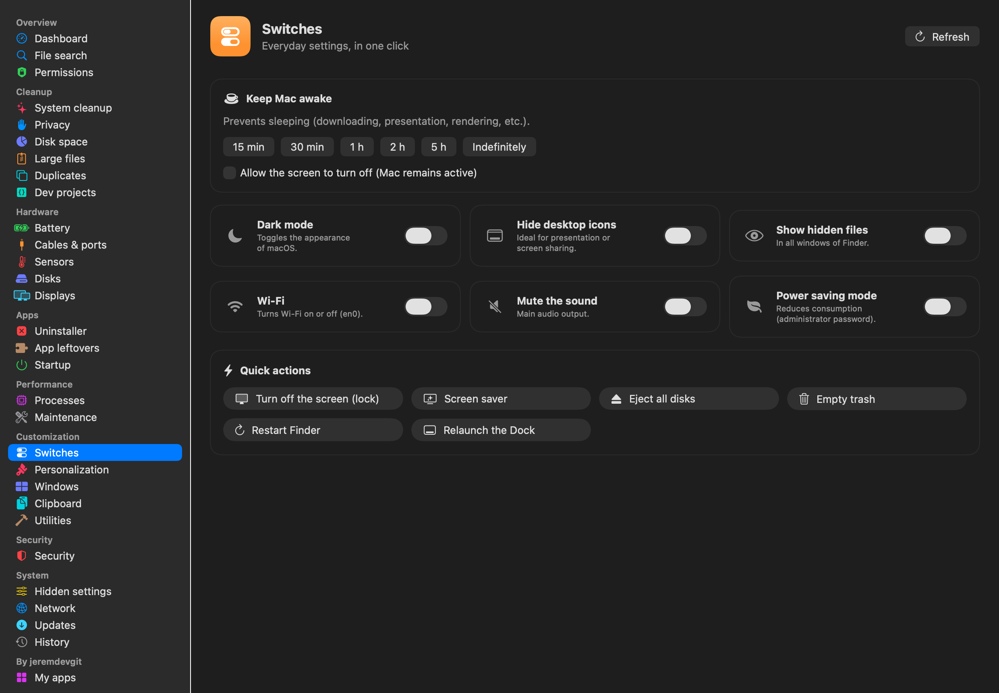</p>
<p>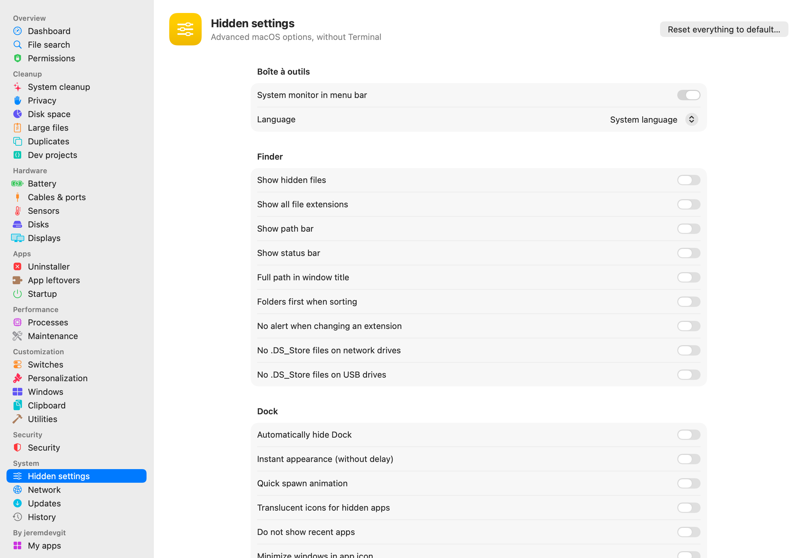 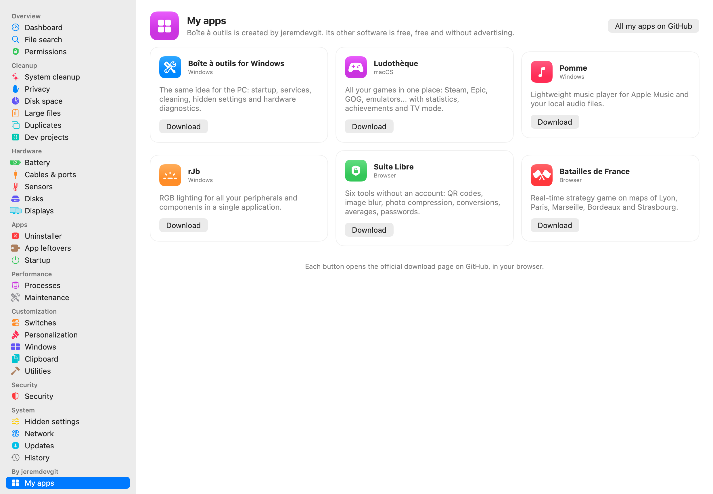</p>
<p>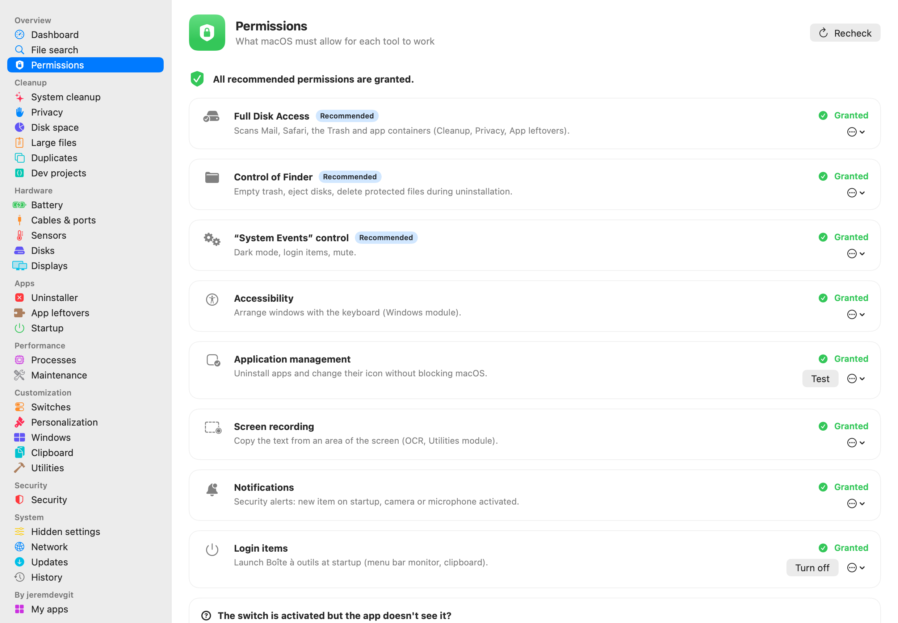 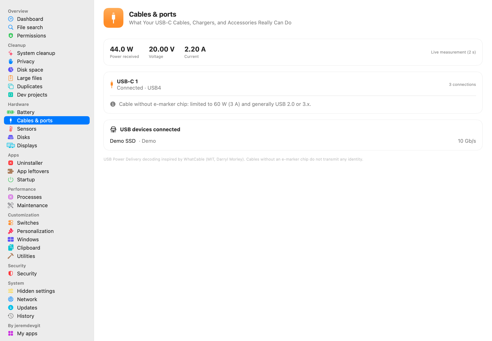</p>

### Installing

- **`.pkg` package (recommended)**: double-click and follow the assistant. **The previous version is closed and removed automatically** before installing; your settings and history are kept.
- **`.dmg` image**: drag "Boîte à outils" to the Applications folder (the Finder offers to replace the old version).

The app isn't notarized by Apple: on first launch, **right-click › Open**, or *System Settings › Privacy & Security › Open Anyway*. To check the files: `shasum -a 256 -c SHA256SUMS-macos.txt --ignore-missing`.

Recommended next: *System Settings › Privacy & Security › Full Disk Access* → add "Boîte à outils" (the app's **Permissions** page guides you step by step).

---

## Privacy and security

- **No telemetry, no account, no ads.** Nothing is sent: everything is analyzed on the computer.
- **Nothing is changed without confirmation**; deletions go to the Trash / Recycle Bin when possible and are logged in the History.
- **Windows**: a restore point is offered before the first change; installed in a protected folder; system libraries loaded only from System32 (no DLL hijacking from the Downloads folder); interface pages served from the executable, native commands accepted only from the interface; external links opened with the user's rights, never as administrator.
- **Services contacted, only when you ask**: Microsoft Update catalog (drivers), live.sysinternals.com (Sysinternals tools), winget (essential software), manufacturers' websites (links), VirusTotal (a file's hash, in the browser, macOS), api.ipify.org ("Show public IP", macOS), Apple's `networkQuality` speed test (macOS).

Found a vulnerability? Please read [SECURITY.md](SECURITY.md) before opening a public issue.

---

## Building

**Windows** — requirements: stable [Rust](https://rustup.rs) and the Visual Studio *Build Tools* ("Desktop development with C++" workload).

```powershell
cd windows
cargo build --release              # target\release\BoiteAOutils.exe
.\tools\release.ps1                # distributed version + checks (no path or identifier of the machine, no dependency on the Visual C++ Runtime)
```

Released versions are built by GitHub Actions ([`.github/workflows/windows.yml`](.github/workflows/windows.yml)) with this same script.

**macOS** — requirements: macOS 14+, Xcode or the Command Line Tools.

```sh
cd macos
./build.sh                         # build/Boîte à outils.app (universal Apple Silicon + Intel)
./make_installer.sh                # dist/*.pkg, dist/*.dmg and SHA256SUMS-macos.txt
./Tests/run_tests.sh               # functional tests (they don't modify any data)
```

## Repository layout

```
windows/src/        Windows program (Rust): window, installer, cleanup, hardware, sensors…
windows/ui/         interface (HTML, CSS, framework-free JavaScript)
windows/ps/         PowerShell scripts called by the interface (reading and changing Windows settings)
windows/assets/     PawnIO driver modules (reading motherboard sensors)
windows/tools/      building the distributed version
macos/Sources/      macOS app (SwiftUI)
macos/Resources/    icon, Info.plist, installer package scripts
captures/           screenshots (demo data)
licences-tiers/     third-party component licenses
```

## License

Code under the **GNU GPL v3 or later** — see [LICENSE](LICENSE). Copyright © 2026 jeremdevgit.

Third-party components (folder [licences-tiers](licences-tiers/)):

- [PawnIO](https://github.com/namazso/PawnIO.Modules) driver modules (Windows) — LGPL-2.1 license, sources at github.com/namazso/PawnIO.Modules;
- USB Power Delivery decoding and SMC access adapted from WhatCable (macOS) — MIT license.

## My other software

All free, open source and ad-free — [github.com/jeremdevgit](https://github.com/jeremdevgit):

| Software | For | In short |
|---|---|---|
| [Carnet Rust](https://github.com/jeremdevgit/carnet-rust) | Windows | encrypted local notes and experimental Joplin/Nextcloud sync · [download ZIP](https://github.com/jeremdevgit/carnet-rust/releases/latest) |
| [JMeca](https://github.com/jeremdevgit/jmeca) | Windows, macOS, Linux | encrypted vehicle maintenance, client folders, service log and fuel tracking |
| [Pomme](https://github.com/jeremdevgit/pomme) | Windows | Apple Music and local music player |
| [rJb](https://github.com/jeremdevgit/rjb) | Windows | RGB lighting for all your devices in one app |
| [Ludothèque](https://github.com/jeremdevgit/ludotheque) | macOS | all your games in one launcher |
| [Suite Libre](https://jeremdevgit.github.io/suite-libre/) | browser | six tools, no account: QR codes, blur, photos, conversions, averages, passwords |
| [Batailles de France](https://github.com/jeremdevgit/batailles-de-france) | browser | real-time strategy game on the maps of five French cities |
