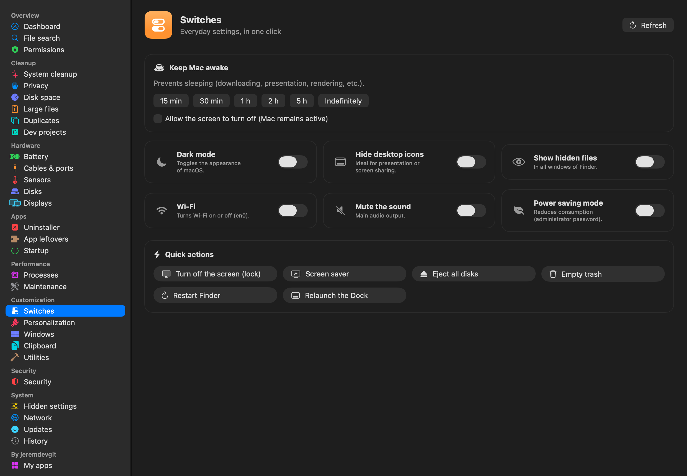

<p align="center"> </p>

<h1 align="center">Boîte à outils</h1>

<p align="center"><b>安全维护电脑：清理、启动项、硬件、传感器、文件搜索——每项更改都可撤销。</b></p>

<p align="center"> <a href="https://github.com/jeremdevgit/boite-a-outils/releases"></a> <a href="LICENSE"></a> <a href="https://github.com/jeremdevgit/boite-a-outils/actions/workflows/windows.yml"></a></p>

<p align="center"><a href="README.md">English</a> · <a href="README.fr.md">Français</a> · <a href="README.es.md">Español</a> · <a href="README.de.md">Deutsch</a> · <a href="README.it.md">Italiano</a> · <a href="README.pt.md">Português</a> · <b>简体中文</b> · <a href="README.ja.md">日本語</a></p>

<p align="center"><a href="https://github.com/jeremdevgit/boite-a-outils/releases/latest"><b>⬇ 下载</b></a></p>


Boîte à outils 用通俗的话解释每一项设置，未经你同意不做任何更改，并把每次更改记录在**历史**中，一键即可撤销。本仓库包含两个原生应用：**Windows 10/11** 版（[`windows/`](windows/)，Rust + WebView2）和 **macOS 14+** 版（[`macos/`](macos/)，Swift + SwiftUI）。

## 概览

| | |
|---|---|
| **类别** | 🛠️ 系统与硬件 |
| **平台** | Windows · macOS |
| **界面语言** | 8 种语言（英、法、西、德、意、葡、中、日） |
| **价格** | 免费、开源、无广告、无遥测 |
| **状态** | 稳定版 |
| **许可证** | [GPL-3.0-or-later](LICENSE) |

## 功能

| 领域 | Windows | macOS |
|---|---|---|
| **启动项与进程** | 程序、计划任务、逐项说明的服务、失效条目 | 登录项、启动代理、进程 |
| **清理** | Windows、浏览器、应用和游戏缓存；默认只勾选安全项 | 系统清理、浏览器隐私、开发项目 |
| **磁盘空间** | 大文件、重复文件、旧版本、遗忘的安装包、残留 | 大文件、重复文件、彻底卸载、孤立残留 |
| **文件搜索** | 按名称或路径建立本地索引，支持通配符、大小和日期筛选 | 同上，Finder 风格 |
| **硬件** | CPU、内存、显卡、SMART 健康、显示器、USB 线缆、驱动、传感器、稳定性测试 | 传感器、磁盘、显示器、电池、USB-C 线缆与端口 |
| **设置** | 有文档说明、可还原的优化（游戏、电源、资源管理器、隐私、广告） | 隐藏设置、开关、窗口、剪贴板、网络 |
| **修复** | 还原点、SFC/DISM、Sysinternals、通过 winget 安装常用软件 | 维护、更新、安全 |

<p> </p>
<p> </p>

文件搜索会为你选择的文件夹或磁盘建立本地索引（首次扫描可能需要几分钟），最多显示 500 个结果，绝不会把路径或内容发送到网上。macOS 各模块的说明见 [`macos/README.md`](macos/README.md)（法语）。

## 安装

**Windows**：从[最新版本](https://github.com/jeremdevgit/boite-a-outils/releases/latest)下载 `BoiteAOutils-Setup.exe` 并运行。已安装的版本会被自动识别并替换，历史、备份和设置都会保留。静默安装：`BoiteAOutils-Setup.exe /S`。程序未使用付费证书签名：如出现 SmartScreen，请选择 **更多信息 › 仍要运行**。可用 `Get-FileHash` 对照 `SHA256SUMS-windows.txt` 校验。

**macOS**：`.pkg`（推荐）会关闭并替换旧版本；`.dmg` 拖拽安装即可。应用未经公证：首次请 **右键 › 打开**。然后授予*完全磁盘访问权限*（**权限**页面会一步步引导）。校验：`shasum -a 256 -c SHA256SUMS-macos.txt --ignore-missing`。

## 安全与隐私

- **无遥测、无账号、无广告。** 所有分析都在本机完成。
- **未经确认不做更改。** 删除的内容尽量移入回收站/废纸篓；在 Windows 上首次更改前会建议创建还原点。
- 安装在只有管理员能修改的文件夹；系统 DLL 只从 System32 加载；外部链接以你的权限打开，绝不以管理员身份。
- 只有在你请求时才会联网：Microsoft Update 目录、live.sysinternals.com、winget、厂商网站、VirusTotal（文件哈希，macOS）、api.ipify.org 以及 Apple 的 `networkQuality`（macOS）。

## 从源码构建

```powershell
# Windows — Rust stable + Visual Studio Build Tools (C++)
cd windows
cargo build --release
.\tools\release.ps1          # 发布用安装包 + 检查
```

```sh
# macOS 14+ — Xcode 或 Command Line Tools
cd macos
./build.sh                   # 通用应用（Apple Silicon + Intel）
./make_installer.sh          # .pkg、.dmg 和校验值
./Tests/run_tests.sh
```

发布版本由 GitHub Actions 构建（[`windows.yml`](.github/workflows/windows.yml)）。

## 许可证

GNU GPL v3 或更高版本，见 [LICENSE](LICENSE)。第三方组件见 [`licences-tiers/`](licences-tiers/)：[PawnIO](https://github.com/namazso/PawnIO.Modules) 模块（LGPL-2.1，Windows 传感器），以及改编自 WhatCable 的 USB Power Delivery / SMC 代码（MIT，macOS）。

---

发现安全漏洞？请私下报告（见 [SECURITY.md](SECURITY.md)），不要发公开 issue。

## jeremdevgit 的其他自由软件

全部免费、开源、无广告。

**🛠️ 系统与硬件** — [rJb](https://github.com/jeremdevgit/rjb) · [LJ Hub](https://github.com/jeremdevgit/lj-hub) · [Decklight](https://github.com/jeremdevgit/decklight)

**📒 效率与数据** — [Carnet de notes](https://github.com/jeremdevgit/carnet-rust) · [JMeca](https://github.com/jeremdevgit/jmeca) · [Suite Libre](https://jeremdevgit.github.io/suite-libre/)

**🎮 音乐与游戏** — [Pomme](https://github.com/jeremdevgit/pomme) · [Ludothèque](https://github.com/jeremdevgit/ludotheque) · [AutoDex](https://github.com/jeremdevgit/autodex) · [Batailles de France](https://github.com/jeremdevgit/batailles-de-france)
